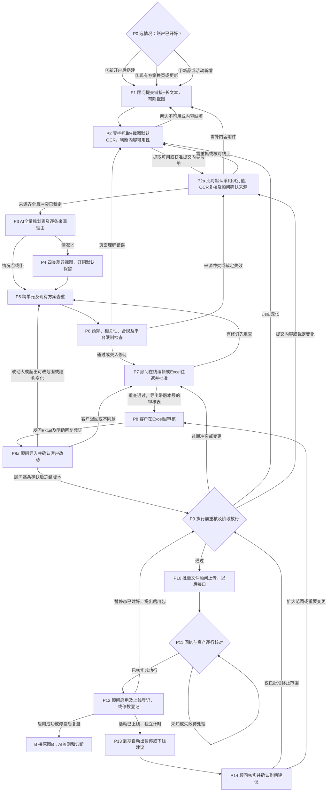
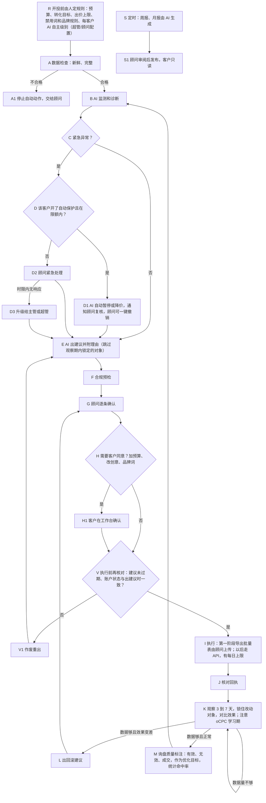

> **2026-10-29 review16_out.md修复轮16完成**：开发时间本轮评审读取至测试、CI与OSS封存。补真实main.app生产初始化门禁、顾问管理拒绝及15×29=435项端点矩阵和12项初始化参数回归；完整切片708 passed/4 skipped，全库2666 passed/46 skipped、diff --check通过。200c0901普通push原slice5/Draft #823目标slice4；主CI五项及GEO两项全绿、部署SKIPPED，远端全库2688 passed/24 skipped，SLICE5_NATIVE_PG_EXECUTED日志证明本head原生PG非skip。保留fail-closed及上线前SOP，非小改建议列交接；PLAN.v11及全部历史保留，最终OSS SHA-256见PHASE1A_SLICE5_HANDOFF.md/status12.md。

> **2026-10-29 review17修复完成**：开发时间从本轮评审读取/修复开始至测试、普通push、CI及OSS封存；task12范围内管理面鉴权说明/回归与main附件协议注入成功路径补齐，显式端点断言和上线前初始化/孤儿治理/迁移顺序清单更新。提交e6519f5b，Draft #823目标slice4/91c89a08；完整切片715 passed/4 skipped、受保护全库2673 passed/46 skipped；本head主CI五项及GEO两项SUCCESS、部署SKIPPED，远端全库2695 passed/24 skipped，日志明确SLICE5_NATIVE_PG_EXECUTED非skip。无生产操作；最终交接/剩余边界/OSS SHA-256见PHASE1A_SLICE5_HANDOFF.md的review17节及status12。PLAN.v11原备份保留。

> **2026-10-29 阶段1a第五刀完成（task12）**：开发时间从status12步骤1起至测试、提交、CI与OSS封存；仅来源/附件生产存储适配、0079新增迁移、main.py正式影子与授权管理入口及完整权限矩阵。空授权数据所有人403、未登录401，附件后端未配置固定拒绝；无新环境开关/生产配置，无生产操作、无百度同步OAuth/执行/前端变更。完整本地切片652 passed/4 skipped，本机全库2610 passed/46 skipped；提交177c0cde、Draft #823目标slice4/91c89a08，主CI五项与GEO全绿、部署SKIPPED，远端全库2632 passed/24 skipped，日志明确SLICE5_NATIVE_PG_EXECUTED新增原生PG实际执行通过；PLAN.v11原样备份保留，最终见PHASE1A_SLICE5_HANDOFF.md/status12.md。

> **2026-10-29 review15_out.md修复轮15完成**：开发时间本轮评审读取/实现至测试、CI与OSS封存；补范围内重要4原生PG跨tenant修改account_id拒绝及绑定回滚断言，修预览上传前读取拒绝文案并验证附件未读，明确cleanup自有连接/事务。提交91c89a08普通push原slice4/Draft #822目标slice3；完整切片238 passed/3 skipped，本机全库2196 passed/45 skipped，远端全库2217 passed/24 skipped，主CI五项与GEO全绿、部署SKIPPED；日志确认本head新增原生PG断言实际执行。生产挂载/0078生产运维/审计第二写入口仍留后续，SOP残余风险明确。PLAN.v10与历史保留；交接/status及5份变更文档OSS SHA-256回读见PHASE1A_SLICE4_HANDOFF.md本轮节、status11.md。

> **2026-10-29 review14_out.md修复轮14完成**：开发时间本轮读取/实现至测试、CI与OSS封存；修复范围内重要3账户授权管理SEM模块门禁：挂起/关闭/过期/缺失403，同事务锁定、两类管理员HTTP/服务与无变更回归；重要4按审查允许方案补审计仅服务写入SOP，历史cleanup指向当前口径。提交92c7cb52普通push，同一slice4/Draft #822目标slice3；完整切片237 passed/3 skipped，本机全库2195 passed/45 skipped，远端全库2216 passed/24 skipped，主CI五项与GEO全绿、部署SKIPPED，日志确认本head原生PG实际执行。生产挂载、0078生产运维、原生PG管理路径扩测留后续；PLAN.v10保留，终版交接/status与5份文档OSS SHA-256读回见PHASE1A_SLICE4_HANDOFF.md本轮节、status11.md。

> **2026-10-29 review13_out.md修复轮13完成**：开发时间从status11修复轮13步骤1（17:06:34+08:00）至本次CI/封存；修复task11/task11b范围内重要3/4及可小改建议：历史cleanup/schema口径、空phase1a schema实际0077→0078升级及generation/审计表断言、API Key超管全部管理HTTP拒绝、13处业务ShadowError断言。提交20f671f3普通push，同一slice4/Draft #822目标slice3；完整切片237 passed/3 skipped，本机全库2195 passed/45 skipped，远端全库2216 passed/24 skipped，主CI五项与GEO全绿、部署SKIPPED，日志确认本次原生PG实际执行。生产挂载/全端点矩阵及0078生产巡检/索引窗口仍另定；无生产/.env/CI/新开关/合并部署/对外联系。PLAN.v10保留，终版交接/status与五份变更文档OSS SHA-256回读见PHASE1A_SLICE4_HANDOFF.md本轮节、status11.md。

> **2026-10-29 阶段1a第四刀续做（task11b）**：开发时间从status11“续做 步骤1”开始；只做review12三项修复及未挂载账户授权管理。已补PG清理SKIP LOCKED/SQLite写锁、新增0078同租户数据库约束与授权代次/事务审计，slice2 API统一授权适配器并补建议。管理路由仅在显式测试app验证真实JWT/require_admin，app/main.py、CI、百度同步/OAuth均未改，无新环境开关。本地完整切片237 passed/3 skipped，全库2195 passed/45 skipped；提交37dd5f1a、Draft PR #822目标slice3；远端全库2216 passed/24 skipped，主CI五项与GEO baseline全绿，部署SKIPPED；日志明确确认新增原生PG清理/真实apply并发和复合FK实际执行通过。生产挂载留待用户确定阶段0来源/附件生产持久化范围；完整1a未完成。PLAN.v10保留，终版提交/PR/CI与OSS回读见PHASE1A_SLICE4_HANDOFF.md、status11.md。

> **2026-10-29 阶段1a第四刀停止（task11）**：开发时间本轮启动至结构预检结束（时间见status11）。远端slice3尖端20236d34已核实，已建立指定slice4分支/worktree，PLAN改前原样备份PLAN.v10.md。预检发现挂载所需阶段0来源只有本地SQLite实现，0077没有生产来源表/适配器；现有影子服务创建和每次读取都依赖来源版本/hash复核。按task11“结构与假设不符且需越界才能做”停止，未扩展未列明的来源持久化范围。范围A三项、授权管理、路由挂载及0078均未实施；无新代码提交、PR或CI，不宣称完成。停止交接见PHASE1A_SLICE4_HANDOFF.md与status11.md。

# SEM 自动化 / 半自动化方案（流程节点版，2026-10-27）

> **2026-10-29 review11修复轮**：开发时间03:31记录起、03:35提交，CI/封存至本轮结束。修复生产HTTP错误传播、resolve空绑定拒绝、第一刀API授权链；补完整PG验收要求及账户provisioning SOP，保留无写入口下的DB复合约束残余风险。修复提交20236d34，仍为slice3/Draft #821，不合并不部署。本地完整切片228 passed/2 skipped、全库2186 passed/44 skipped；远端全库2206 passed/24 skipped，主CI与GEO baseline全绿、部署SKIPPED。最终OSS回读见交接新增章节与status10。

> **2026-10-29 阶段1a第三刀开工（task10）**：开发时间从本轮开始记录；仅修五项审查重要问题、真实会话与账户授权适配、未挂载PostgreSQL存储代码及新增迁移。只做本地合成验证，不连生产。独立slice3 worktree，Draft叠#820，不合并、不部署、不联系他人。改前备份PLAN.v9.md；交付见PHASE1A_SLICE3_HANDOFF.md、status10.md。

阶段1a第三刀进度：五项重要及七条小建议已修复/验证，精确账户授权、DB角色核对、客户只读与不可执行演练语义统一；新增未挂载真实会话工厂及PostgreSQL事务/CAS存储、仅新增0077迁移。开发时间03:17起、03:25首提交，CI/交付至本轮结束；本地226 passed/2 skipped，远端CI全绿（pytest全库2204 passed/24 skipped），GEO baseline成功、部署SKIPPED。Draft PR #821 https://github.com/DoraHai/ai_sni/pull/821，提交a91ca93d，目标slice2。真实顾问新路径/写门禁继续关闭，迁移未在生产执行，不合并不部署；完整1a未完成。

> **2026-10-29 阶段1a第二刀开工（task9）**：本刀开发时间估算12～20h（非实际用时），仅隔离SQLite持久化/跨进程事务、只读授权适配、多方案多单元与结构编辑及Cursor审查修复。独立worktree，Draft PR叠在#819；不合并、不部署。真实抓取/OCR、情况②、正式客户确认及百度执行出口继续关闭。改前原样备份PLAN.v8.md；交付见PHASE1A_SLICE2_HANDOFF.md、status9.md。

阶段1a第二刀本地进度：已实现独立SQLite事务/CAS与预览TTL、只读本地授权适配、多产品线/多页及顾问结构编辑，并修Cursor列出的七项问题。203项本地合成单元/API/并发测试通过，Draft PR #820：https://github.com/DoraHai/ai_sni/pull/820，提交c22fba9d，目标为第一刀分支。仅本切片，完整1a未完成；五项远端CI全SUCCESS、部署SKIPPED，OSS终态见status9.md。

> **2026-10-28 阶段1a第一刀开工（task8）**：已批准仅实施①新开户、③新品/活动的合成影子规划骨架；本刀一次性开发时间估算12～20h，阶段1a全量仍为85～135h开发时间。接续阶段0提交23c39b4，独立分支/worktree及Draft PR；仅本地合成HTML/文本/假OCR、规则模板生成、查重与复用P6、内部Excel往返与逐项批准、客户审核演练及到期建议。不接真实HTTP/OCR/模型，不做情况②、正式客户确认、P9以后执行、合并或部署。改前原样备份PLAN.v7.md；最终交付见PHASE1A_SLICE1_HANDOFF.md及status8.md。

阶段1a第一刀本地进度：已实现fixture影子来源裁定、全规划树、P5/P6、内部Excel往返/逐项演练复核、客户差异演练及到期建议；134项本地合成测试通过；Draft PR #819：https://github.com/DoraHai/ai_sni/pull/819（叠在#818上）。仅本切片，完整1a未完成；真实HTTP/OCR/模型与正式确认/执行出口继续关闭。最终CI/OSS见status8.md。

> **2026-10-28 阶段0批准与本轮范围（task7）**：用户已批准开干阶段0，一次性开发时间估算11～18h，不是日常运行耗时。先做①新开户与③新品/活动，②换页留到1b。顾问不能代客户确认预算、品牌、结构；仅纯格式且投放内容不变可顾问复核。阶段0只实施P1输入/预算契约、P6可配置规则骨架、P10公开官方模板核实与内部合成样例；不实施完整规划AI或影子流水线，不生成可上传百度的正式文件。OCR供应商/账号/额度须另批，本轮不接OCR、不抓真实客户页、不调百度业务写接口、不动同步/授权，不部署或合并。阶段0交付与实际验证结果见 PHASE0_HANDOFF.md、status7.md；阶段1a须本阶段汇报后另开。本轮改前基线已原样保存为 PLAN.v6.md。下文历史轮次的“本次未实施”等陈述仅适用于原轮次；流程图实质不变。

阶段0本地交付进度：P1可挂接输入契约/版本存储、P6规则骨架、P10官方模板摸底与内部合成JSON已实现，本地67项测试通过；Draft PR #818：https://github.com/DoraHai/ai_sni/pull/818。生产入口未挂接；阶段1a第一刀已另获task8批准，其他完整1a及以后未启动，当前正式模板全部待核实，正式导出关闭；阶段0结果见status7.md，本刀见status8.md。

## 流程

### 附录 P0 本次增补的阅读口径

历史v3基于PLAN.v2.md增加P支线，原23节点及附录A～O和后续历史记录保留。当前task6以PLAN.v5.md为基线，按用户2026-10-27 18:53及18:57决定：OCR已定开启（可用外部服务）；内容冲突默认采用系统识别出的页面内容（抓取＋OCR）；客户经邮件或日常沟通群发链接给顾问，页面内容全部由顾问整理并在顾问工作台「提交落地页」提交。客户工作台只读，P8/P8a客户Excel往返审核不变。本轮仅文档，未重查源码/服务器，未实施或调用OCR/业务API；仅只读公开官方OCR文档和指定OSS文档交付。历史调查、SQL/命令、旧工时及旧轮次声明不代表task6行为，不执行其中命令。现行总计见S.2，task5自查W保留为历史，task6改动与全节自查见Y。

除K.16～18三项已定决定外，新增阈值/实施策略/耗时均为未来建议默认、待拍板。本次未实施、未抓客户落地页、未调任何业务/百度/第三方API；仅指定OSS文档传输为外部交付。开户本身由系统外人工完成。账户未开好、输入不可用、抓取及提交内容两边均不可用或硬检查未通过时阻断；单侧抓取失败按P2/P2a用提交内容降级理解，不直接进入执行；图中省略的失败分支不代表可跳过。





当前为task6文档修订，源码证据沿用v3/v4/v5历史引用，未重新核实线上状态或实施功能。P支线保留Excel往返P8a，新增URL＋内容输入与P2a比对裁定；原优化图保留。原图H1名称为历史标注，其实际确认方式按用户10-27 18:27决定同样改为Excel往返，客户工作台仍只读。版本及S:/F:/O:/G:证据口径见附录N。

所有阈值均为“建议默认，待拍板”，并非现网值。以下开发时间是未来实现估算，不是本次文档用时，不含人工或等待。按阶段拆增量，公共基础单列；现状“部分”含其他模块可借鉴模式，不代表SEM节点已闭环。风险A/B/C/D见附录B。

## P0 选情况与确认账户已开好

| 项目 | 内容 |
|---|---|
| 谁做 | 顾问主；客户提供业务情况；AI辅助 |
| 做什么、判断条件和阈值 | 选择①新开户后的首次搭建、②现有方案换页/更新、③新品/活动新增。开户资质、合同、充值和开户流程由人在系统外完成；账户未开好、租户/账户归属不明或SEM暂停则只保存草稿。建议默认，待拍板：一次规划绑定一个租户和一个账户，项目可含多产品线。 |
| 现有代码有没有；可复用与要补什么 | **部分**；`S:app/api/onboarding_builder.py:39`、`:607`、`F:customer-workbench/js/workbench-entry.mjs:85`。可借输入和租户校验；要补三种任务类型、账户就绪声明、SEM工作台入口与后端授权，当前入口只列SEO/GEO。禁止隐式同步。 |
| 属于哪个阶段 | 1a；仅新增增量，阶段定义见附录S |
| 风险层级 | A/D（沿用附录B） |
| 本节点的 开发时间 | 1a：1～2h；未来实施估算，不含人工/等待 |

## P1 输入产品线、每页URL＋页面内容和投放边界

| 项目 | 内容 |
|---|---|
| 谁做 | 顾问主（唯一系统提交角色）；AI检查 |
| 做什么、判断条件和阈值 | 每条产品线的每个落地页必填URL＋页面内容，情况①新开户、②换页/更新、③新品或活动完全同用。客户仅经邮件或日常沟通群把链接发给顾问；顾问负责整理全部页面内容，在顾问工作台「提交落地页」填写链接＋一个长文本表单框（页面内容），另可上传截图（图片）。上传类型只保留截图.png/.jpg/.jpeg＋粘贴文本，不保留TXT/DOCX/PDF等页面文档上传，也不设客户内容Excel输入渠道。截图默认走 OCR 认字，仍须P2a比对及顾问确认，低置信度先复核；OCR失败则顾问补文字/重交截图，不静默丢内容。客户不在系统提交，工作台仍只读。每页绑定landing_page_id、URL、内容/附件版本、提交人/实际上传顾问及授权范围，不混配多页附件。继续收集现有方案/单元ID（②）、预算币种/周期、地域意图、时段时区、价帽、品牌否词、目标和活动起止；缺关键字段阻断，不套100元默认；长期新品无截止须显式选择。输入契约及安全见P.1/V；本次不接收客户文件或抓页。 |
| 现有代码有没有；可复用与要补什么 | **部分**；`S:app/api/onboarding_builder.py:39`、`:188`、`S:app/models/campaign.py:38`、`:42`、`:45`。可复用时段归一和预算/地域字段；要补多产品线/多链接、日期/预算周期、快照引用及必填校验。均为内部字段，不是百度表头。；本轮改为顾问「提交落地页」链接＋长文本＋截图入口、图片防护/清洗和每URL版本关联；删除客户内容渠道适配、代传身份分支及页面文档解析，不新增客户上传功能。沿用v4文件:行，未重新核对代码。 |
| 属于哪个阶段 | 0 / 1a；仅新增增量，阶段定义见附录S |
| 风险层级 | D/A（沿用附录B） |
| 本节点的 开发时间 | 0：1～2h；1a：3～5h；较v5分别－1～1h、－2～3h，取消客户内容渠道/页面文档解析；未来实施估算，不含人工/等待 |

## P2 先受控抓取URL并判断内容可用性

| 项目 | 内容 |
|---|---|
| 谁做 | AI主；顾问复核来源 |
| 做什么、判断条件和阈值 | 未来先抓客户明确授权的公开URL，仅HTTP(S)、80/443，逐跳检查全部解析地址为公网并固定连接已检查IP；总计25秒含DNS/重定向，正文≤3 MiB（3,145,728字节），最多5次重定向。不执行脚本/提交表单，保存原/最终URL、抓取时刻/状态、正文hash及段落ID。截图默认走 OCR 认字（顾问上传截图；不额外抓图/渲染），结果标「来源：OCR」和截图编号/区域定位，保留引擎版本、原始分数及映射。先采用系统识别内容（抓取＋OCR）；抓取失败/文字不足时用截图OCR补识别，识别仍缺失才用顾问整理文字补充，并标降级原因。所有OCR文字必须P2a比对和顾问确认，低置信度先复核，不能直接写进创意。建议默认待拍板：去导航去重复后正文非空白字符＜200为文字不足；静态尺寸可可靠估算时，正文区图片面积/正文区面积≥60%且正文字符＜500为疑似图片为主。面积不可可靠取得则标未知交顾问判断，不能算0或只按图片数量判定，不为判定额外渲染/抓图。阈值仅作分流须按页面类型校准，不能证明线上没有文字。两边有内容均进P2a比对；两边不可用或输入内容缺项回P1，不编造。限频/防护沿用附录P，详细来源规则见V。 |
| 现有代码有没有；可复用与要补什么 | **部分，可复用防护模式**；`G:app/geo/content/article_import.py:199`、`:213`、`:219`；`G:app/geo/audit.py:17`、`:197`、`:221`、`:259`、`:269`、`:306`；`G:app/geo/content/routes.py:6949`；`G:app/geo/content/article_import_throttle.py:15`、`:67`。要补SEM受控服务、授权域范围、全角色/跨进程配额，传article_import=True；不能调用GEO业务接口冒充复用，不照搬完整审计额外抓robots/llms。；本轮补文字不足/图片占比信号、未知状态，以及单一OCR后端适配、结果归一、失败回退、开关/配额/审计；接入本地或外部的工时差异见S.2/X。沿用v4文件:行，未重新核对代码。 |
| 属于哪个阶段 | 1a；仅新增增量，阶段定义见附录S |
| 风险层级 | A（沿用附录B） |
| 本节点的 开发时间 | 1a：12～19h；较v5＋6～10h，单家外部OCR适配/回退/开关审计；未来实施估算，不含人工/等待 |

## P2a 内容比对与冲突裁定

| 项目 | 内容 |
|---|---|
| 谁做 | AI逐事实比对标冲突；顾问逐项裁定；必要时客户补证/重批 |
| 做什么、判断条件和阈值 | 将每页抓取文本与顾问粘贴文字、截图OCR或顾问人工校正文本按版本对照，标一致、仅抓取有、仅提交有、冲突、无法核实。重点比产品名/型号、价格/优惠/期限、性能承诺、资质品牌、联系方式/URL，保留双侧原文定位，不能用总体相似度掩盖关键冲突。已定：默认采用系统识别出的页面内容（抓取＋OCR），顾问提交文字只补抓不到或识别不出的部分；冲突仍逐项展示，默认选识别值，顾问确认或改判并记录。系统内部抓取/OCR互相冲突也须展示并由顾问裁定，不能因默认优先级自动放行。截图默认走 OCR 认字；全部OCR文字须本节点比对和顾问确认后才可进入创意事实。建议默认待定：归一化置信度＜0.90、缺失或不可比较均标待复核；关键价格/型号/期限/资质无论分数均人工核对，分数高也不等于事实。抓取及OCR均不可用时仅用顾问文字作阻断草稿，标未核实线上；仅顾问提交有的事实不能推定线上已有。记录选用值、双侧来源、原因、顾问身份/时间/证据；可要求改提交内容、等待线上更新后重抓或去掉无证据主张。未裁定停留，补内容回P1，核对线上回P2；齐全且裁定完才进P3。可保存阻断草稿，不能作为可批准全包。来源版本变化使裁定和旧批准失效，经P3～P8a重查重批；情况②/③同用。 |
| 现有代码有没有；可复用与要补什么 | 无（新增规划节点，不新增现状证据断言）；借P2防护及P7/P8a版本/差异模式，需建抓取/OCR/顾问文本片段索引、事实比对、默认采用识别值/人工改判记录、置信度复核队列、冲突组、顾问裁定、来源冻结及审批失效联动；不得调用SEO/GEO业务接口冒充复用。 |
| 属于哪个阶段 | 1a / 1b；1a先建共用演练能力，1b仅换页历史来源迁移/失效适配，见S |
| 风险层级 | A/D；涉及广告事实或客户批准变更按C/D，沿用附录B |
| 本节点的 开发时间 | 1a：7～11h；1b：1～2h；较v5仅1a＋2～3h，置信度复核及识别优先/改判；v4无此节点；未来实施估算，不含人工/等待 |

## P3 AI生成全量规划表并附理由和段落来源

| 项目 | 内容 |
|---|---|
| 谁做 | AI主；顾问定策略 |
| 做什么、判断条件和阈值 | 保留项目→方案→单元→关键词/基础创意/高级创意树，一产品线一方案、同线多页归方案、每单元一页，同页拆意图须说明并查重。每一规划行有稳定ID、父ID、状态、理由、source_refs及待核实假设；来源列为抓取/OCR/提交/冲突已裁定，多来源逐条展开；OCR标「来源：OCR」及截图编号/区域，另有原始及归一化置信度、复核状态/人/时间，须P2a比对和顾问确认。抓取定位为URL/快照hash/时刻/段落ID；提交定位为提交版本、文件名/附件ID/截图编号及页码/段落/区域、文本hash；冲突已裁定链到双侧片段和顾问裁定。预算/地域/日期等非页面约束标提交并定位输入模板字段/行号，历史事实另附资产快照/统计窗口；AI推断单列待核实，不伪装事实来源。词给匹配/出价/测算预算，否词给层级/类型；高级创意列候选类型/文案/素材需求/目标页，平台未核实不称可上传。任一来源缺失/冲突未裁定阻断批准，详见P.1/V。 |
| 现有代码有没有；可复用与要补什么 | **部分**；`S:app/api/onboarding_builder.py:368`、`:400`、`:493`、`:809`。现归一化在`:405`、`:410`各只取一个计划/单元，`:385`最多3条基础创意；单URL请求缺项目、多产品线、高级创意和来源闭环。要补统一规划Schema、来源/预算分配、AI失败降级，不能静默截断。`:835`会预热拓词，离线路径必须拆开，不能生成草稿顺带请求百度。；本轮另补逐行抓取/OCR/提交/裁定来源和双侧定位及审核表来源呈现。沿用v4文件:行，未重新核对代码。 |
| 属于哪个阶段 | 1a / 1b；仅新增增量，阶段定义见附录S |
| 风险层级 | A/D（沿用附录B） |
| 本节点的 开发时间 | 1a：8～13h；1b：2～3h；较v5仅1a＋1～2h，OCR来源及审核表列；未来实施估算，不含人工/等待 |

## P4 情况②逐项差异视图和好词保护

| 项目 | 内容 |
|---|---|
| 谁做 | AI主；顾问决断；客户审核重要变更 |
| 做什么、判断条件和阈值 | 仅情况②进入。完整当前资产快照对比新页面，对单元、词、基础/高级创意、否词和预算/地域/时段逐项标“保留/剔除/新增/修改”，列旧新值、理由、来源段落、历史窗口和影响依赖。无关项建议剔除、新内容补入；执行层剔除默认暂停/解绑，不永久删除。历史有转化或顾问标“表现好”的词醒目标红、默认保留；表现好建议按最近28天有效询盘成本≤客户目标且样本足，样本门槛待配置。历史未知/缺失也默认保留。顾问显式改选并说明，核心/品牌/历史好词剔除须客户再批。旧页面未获准不得补抓。 |
| 现有代码有没有；可复用与要补什么 | **部分，差异视图待建**；`S:app/models/campaign.py:64`、`S:app/models/keyword.py:35`、`:49`及v2 `S:app/models/kw_report_snapshot.py:29`。补完整资产导入、稳定ID映射、历史保护/缺数标记和逐行差异。现词库仅覆盖曾有展现的词，不能当账户全量；不能只因新页未提到就删好词。 |
| 属于哪个阶段 | 1b；仅新增增量，阶段定义见附录S |
| 风险层级 | A→C/D（沿用附录B） |
| 本节点的 开发时间 | 1b：5～8h；未来实施估算，不含人工/等待 |

## P5 跨单元和现有方案查重防内部抢量

| 项目 | 内容 |
|---|---|
| 谁做 | AI主；顾问裁定 |
| 做什么、判断条件和阈值 | 全部情况检查本批及已有计划/单元，情况③必须与常规/新品/活动方案查重。规范化词文本但保留原文，结合匹配、落地页、意图、地域、设备、日期/时段重叠形成冲突组；重叠须顾问选归属/合并/互斥，不自动删好词。建议默认，待拍板：规范化精确重复且范围重叠为硬阻断，语义近似提示并要求处理说明；不把同词即竞争当事实。快照覆盖不足标未完成，阻断执行。 |
| 现有代码有没有；可复用与要补什么 | **部分**；`S:app/models/keyword.py:49`、`:51`、`:53`与`S:app/models/campaign.py:42`、`:45`可做关联，`S:app/api/onboarding_builder.py:276`仅候选词合并。补跨方案冲突索引、范围交集和裁定留痕，字符串去重不等于竞价诊断。 |
| 属于哪个阶段 | 1a / 1b；仅新增增量，阶段定义见附录S |
| 风险层级 | A/D（沿用附录B） |
| 本节点的 开发时间 | 1a：2～3h；1b：1～2h；未来实施估算，不含人工/等待 |

## P6 自动检查预算、相关性、合规和平台限制

| 项目 | 内容 |
|---|---|
| 谁做 | AI主；顾问终审 |
| 做什么、判断条件和阈值 | 保留预算币种/周期/父子合计、查重、否词误伤、页面相关性、品牌资质/夸大及平台限制检查；同周期按分、合计误差0分，未分配显式列出，字数按官方口径，硬限制未知阻断执行。新增每行来源完整性、提交事实在当前线上页面可核实性及冲突裁定状态检查。来源冲突/裁定失效回P2a、理解错误回P2、内容缺失经P2a回P1、其他修订回P7重查。顾问整理的补充文字可能线上没有，广告落地页不符可能影响质量度/审核（规划风险提示，非本轮外部核验结论）。抓取不可用可凭提交内容出阻断草稿，但顾问人工核验线上一致性并留时刻/版本/定位证据前，不放行广告主张，不能借默认识别优先或顾问补充绕过合规门槛；OCR待复核/未确认也阻断。 |
| 现有代码有没有；可复用与要补什么 | **部分**；`S:app/api/onboarding_builder.py:380`、`:381`、`:405`、`:649`是内部截断/区间，不是百度限制证据；`S:app/baidu/services/creative.py:11`仅基础创意。可借v2 F合规流程，补预算约束、来源相关性、否词误伤、平台限制版本契约及错误定位。；本轮另补来源/线上一致性及未裁定阻断检查。沿用v4文件:行，未重新核对代码。 |
| 属于哪个阶段 | 0 / 1a / 1b；仅新增增量，阶段定义见附录S |
| 风险层级 | A/D（沿用附录B） |
| 本节点的 开发时间 | 0：2～3h；1a：6～10h；1b：2～3h；较v5仅1a＋1～2h，OCR确认阻断检查；未来实施估算，不含人工/等待 |

## P7 顾问在线编辑或Excel往返并逐项批准

| 项目 | 内容 |
|---|---|
| 谁做 | 顾问主；AI重新检查 |
| 做什么、判断条件和阈值 | 工作台编辑树/差异，或内部规划Excel导出→修改→导入预览→确认。校验tenant/account/批次/Schema、行ID/父ID、原revision/hash；重复ID、范围越界、公式/宏/外链、未知列或对象歧义拒绝。仅白名单业务字段可改，来源/操作者/审批不接受回填；删行不等于批准剔除，须差异预览。顾问逐项批准后冻结整包hash，重跑P5/P6再送P8；编辑使旧确认失效。1a仅允许标“内部规划/演练，不可上传百度”的Excel，无可执行文件。 |
| 现有代码有没有；可复用与要补什么 | **部分**；`S:app/api/onboarding_builder.py:400`为草稿结构，`F:customer-workbench/js/host-session-adapter.mjs:39`有版本确认模式，v2 `O:app/seo_distribution_import.py:131,233`有导入预览模式。补SEM树/差异编辑、独立Excel往返、并发冲突、审批重置及两类文件分离。 |
| 属于哪个阶段 | 1a / 1b；仅新增增量，阶段定义见附录S |
| 风险层级 | A→C/D（沿用附录B） |
| 本节点的 开发时间 | 1a：4～6h；1b：2～3h；未来实施估算，不含人工/等待 |

## P8 客户在 Excel 里审核

| 项目 | 内容 |
|---|---|
| 谁做 | 客户主；顾问从顾问工作台导出、发送和解释；系统外往返 |
| 做什么、判断条件和阈值 | P7重查通过后导出客户审核Excel，客户直接在可改列修改后发回。表带版本号、规划hash、tenant/account、批次/Schema、稳定行ID/父ID及校验列，锁定/隐藏结构列并醒目标明客户可改列；锁列不能代替服务端校验。客户须明确同意准确版本及范围；仅发回改表不等于自动同意全包。三种情况首次全包和附录R实质变更均须客户确认。P14扩大范围或重要变更仍回P8再发Excel；客户退回/不同意由P8a记录后回P7。无修改同意也须明确回复凭证，沉默/已读不算确认。发回原文件及邮件或微信截图/聊天记录按R.1留档。客户工作台只看不操作，不加审核按钮。 |
| 现有代码有没有；可复用与要补什么 | **部分，客户审核导出待建**；借P7独立Excel及历史SEO版本hash模式，不挪SEO表或调用其接口；补顾问端客户审核导出、版本/校验/锁列、可改列说明、发送登记和凭证关联，不建客户审核页/窄权限接口。防护细则见R.1。 |
| 属于哪个阶段 | 1a演练 / 1b-P正式；仅新增增量，见附录S |
| 风险层级 | C/D（沿用附录B） |
| 本节点的 开发时间 | 1a：2～3h（共用导出/版本/校验/锁列演练）；1b-P：2～3h（正式发送登记与客户凭证绑定）；未来实施估算，不含人工/等待 |

## P8a 顾问导入并确认客户改动

| 项目 | 内容 |
|---|---|
| 谁做 | 顾问主；AI标差异、导入后重新检查；客户补充明确确认凭证 |
| 做什么、判断条件和阈值 | 顾问上传客户发回的原Excel及回复证据；先按R.1校验版本/规划hash/行ID/结构校验列及文件防护，旧版/校验不符拒收并提醒，仅隔离留档、不覆盖规划。系统逐行逐字段展示原值/客户值、范围和风险，顾问逐条接受/拒绝并记原因，不自动采纳。超范围醒目提醒；改动大/超范围/结构变化显式回P5重查，非法结构须顾问重建合法草稿，不直接采纳；客户退回/不同意回P7。所有合法导入重跑P5/P6检查规则，小改可在P8a内复检，重大变更走P5→P6→P7→P8再发新表。若顾问拒绝/改写客户修改或最终投放内容不同于客户明确同意范围，旧确认失效，经P7/P8按新hash重批。仅顾问逐条确认、复检通过、客户同意覆盖最终准确版本且凭证齐全后冻结版本进P9。无修改同意也要导入/关联原审核表及明确回复。 |
| 现有代码有没有；可复用与要补什么 | **部分，客户回表差异及凭证闭环待建**；借P7导入预览和历史版本冲突/实名审计模式，补SEM顾问端导入、差异确认、超范围提示、复检及附件关联。客户改Excel不能伪装客户工作台操作，记录实际客户来源与上传顾问。公式/宏/外链、大小行数及留档细则见R.1。 |
| 属于哪个阶段 | 1a演练 / 1b-P正式；仅新增增量，见附录S |
| 风险层级 | C/D（沿用附录B） |
| 本节点的 开发时间 | 1a：3～5h（共用导入比对/文件防护演练）；1b-P：5～8h（超范围提醒、逐条确认、复检和正式凭证留档）；未来实施估算，不含人工/等待 |

## P9 执行前重核版本、资产、范围和额度

| 项目 | 内容 |
|---|---|
| 谁做 | AI主；顾问核对百度当前状态 |
| 做什么、判断条件和阈值 | 核对授权/模块、顾问客户完整Excel确认链、规划hash/规则/模板、资产指纹、重名父子对象、剩余额度和活动期限；新增抓取/OCR/提交版本hash、OCR引擎/置信度/复核状态、顾问裁定及线上一致性证据，须覆盖最终规划。建议默认待拍板：确认24小时到期、执行文件30分钟使用窗；一般变更回P7，页面变化回P2，提交/来源裁定变化回P2a，旧批准失效，按新版本走P3～P8a重查重批。停投包须P14及必要P8→P8a确认链。无API由顾问在自己的百度后台最终核对声明，系统不能声称原子锁住百度；1a/门槛未到阻断。 |
| 现有代码有没有；可复用与要补什么 | **部分**；`S:app/api/onboarding_builder.py:597`、`:622`、`:634`显示真实搭建禁用；v2 `O:app/distribution_inbox_service.py:364,382`有版本冲突模式。补SEM快照/限额事务/使用窗，不绕过现安全锁；阶段2适配另批。；本轮另补正式来源版本/顾问裁定证据与旧批准失效校验。沿用v4文件:行，未重新核对代码。 |
| 属于哪个阶段 | 1b-P / 2；仅新增增量，阶段定义见附录S |
| 风险层级 | C/D（沿用附录B） |
| 本节点的 开发时间 | 1b-P：5～9h；2：1～2h；较v5仅1b-P＋1～2h，OCR结果/复核版本放行；未来实施估算，不含人工/等待 |

## P10 生成已核实百度批量文件并由顾问上传

| 项目 | 内容 |
|---|---|
| 谁做 | AI生成文件；顾问主上传；以后AI按授权走API |
| 做什么、判断条件和阈值 | 第一阶段仅1b-P放行后可出可执行文件。内部ID/理由另存审计，不混官方模板。按证实能力处理计划→单元→词/创意/高级创意/否词及预算/地域/时段，父ID须经回执映射；名称引用也要核实。建议默认，待拍板：初次暂停态创建，核实后另做启用包；无暂停创建支持/正确模板即阻断。顾问自行上传回收，未知不重传。原每日5对象上限不能自动放宽，批量须另定上限并拆分，不能拆包规避累计配额。 |
| 现有代码有没有；可复用与要补什么 | **部分，离线新建未闭环**；`S:app/api/onboarding_builder.py:616`、`:634`、`:783`；`S:app/baidu/services/creative.py:11`；`S:app/api/manage.py:214`、`:258`、`:465`、`:498`。借依赖/台账，不调这些接口；补新建模板、父子映射、批次幂等、暂停创建/启用包和高级创意。apply强制dry_run，不能切开关冒充交付；API阶段另批。 |
| 属于哪个阶段 | 0 / 1b-P / 2；仅新增增量，阶段定义见附录S |
| 风险层级 | C/D（沿用附录B） |
| 本节点的 开发时间 | 0：2～3h；1b-P：6～10h；2：4～6h；未来实施估算，不含人工/等待 |

## P11 逐行核对回执和新建对象映射

| 项目 | 内容 |
|---|---|
| 谁做 | AI主；顾问提供核对证据 |
| 做什么、判断条件和阈值 | 区分成功/失败/部分成功/未知，以上传结果和上传后资产快照逐行核对父子ID、落地页、匹配/出价、创意版本、否词层级、预算/地域/时段及暂停状态。成功父级才放子级，依赖失败不得靠同名猜ID。平台审核中/拒审与上传成功分开，未生效不认上线；未知停止保留占额，不重发创建。创建包和启用包分别对账。 |
| 现有代码有没有；可复用与要补什么 | **部分，沿用J模式**；v2 `G:app/geo/content/receipt_import.py:103`、`O:app/distribution_inbox_projection.py:60`为回执核验基础；`S:app/api/onboarding_builder.py:524`、`:568`、`:797`有动作状态。补百度回执、新ID映射、部分成功恢复和审核/实际状态分离；dry_run计数不是成功。 |
| 属于哪个阶段 | 1b-P / 2；仅新增增量，阶段定义见附录S |
| 风险层级 | A/C（沿用附录B） |
| 本节点的 开发时间 | 1b-P：3～5h；2：2～3h；未来实施估算，不含人工/等待 |

## P12 顾问启用投放并接入原B监测

| 项目 | 内容 |
|---|---|
| 谁做 | 顾问主；AI建立基线和监测状态 |
| 做什么、判断条件和阈值 | P11先核实暂停态对象及审核条件，顾问提出启用包回P9→P10→P11；使用冻结规划和有效客户授权，过期/变化重批。仅启用已成功且审核通过的行；P11核实启用成功才接原B，登记上线时刻/新ID/预算基线。新账户无28天历史标冷启动/数据不足，小范围上线例外须用户拍板，不伪造A数据合格，不自动优化/保护。原图不改，后续A及K门槛继续；足量前仅监测补数提醒。终止包核实后只登记停投并回B复盘，不再启用。 |
| 现有代码有没有；可复用与要补什么 | **部分，接线待建**；`S:app/api/manage.py:258`、`:465`为启停基础，v2 `S:app/api/sem_tasks.py:217`为后验比较。补暂停建好→启用包→回执状态机、入监测及冷启动标签，既有代码不证明全自动上线。 |
| 属于哪个阶段 | 1b-P；仅新增增量，阶段定义见附录S |
| 风险层级 | C/D（沿用附录B） |
| 本节点的 开发时间 | 1b-P：2～3h；未来实施估算，不含人工/等待 |

## P13 活动到期自动生成暂停或下线建议

| 项目 | 内容 |
|---|---|
| 谁做 | AI主；顾问接收建议 |
| 做什么、判断条件和阈值 | 情况③按确认截止时间在Asia/Shanghai生成一次建议，幂等键为活动ID+截止版本；改期作废旧任务。建议默认，待拍板：到达精确截止时刻即出建议，仅日期须补时分秒，不猜午夜；逾期未处理提示持续花费风险，不自动暂停。只圈活动专用对象，共用计划/单元不可整体停，优先活动新增词/创意暂停；下线默认暂停/解绑，不自动生成永久删除。长期新品显式无到期则不触发；任务独立于B，不因无监测数据丢失。 |
| 现有代码有没有；可复用与要补什么 | **部分，可借调度模式**；`O:app/seo_task_center.py:29`、`:86`、`O:app/seo_automation_runs.py:47`、`:75`、`:91`及v2 `O:app/seo_scheduler.py:135`。补SEM活动时钟、终止范围版本、补跑去重/时区和任务状态，不启动SEO业务任务。本轮不发送提醒。 |
| 属于哪个阶段 | 1a / 1b-P；仅新增增量，阶段定义见附录S |
| 风险层级 | A（沿用附录B） |
| 本节点的 开发时间 | 1a：2～3h；1b-P：1～2h；未来实施估算，不含人工/等待 |

## P14 顾问确认到期建议后走同一执行链

| 项目 | 内容 |
|---|---|
| 谁做 | 顾问主；必要时客户确认；AI检查 |
| 做什么、判断条件和阈值 | 顾问核实延期、对象范围和业务损失后逐项确认回P9；仅客户已批准的终止范围不重复客户确认，超范围/共享/品牌/好词、永久删除或延期增预算先P8。拒绝/延期说明原因；改截止或范围使旧建议失效。绝不因到期绕过顾问；第一阶段顾问上传停投包，阶段2仍人确认。回执同P11，P12只登记停投回B，不循环启用。 |
| 现有代码有没有；可复用与要补什么 | **部分**；`S:app/api/manage.py:258`、`:465`、v2 `S:app/api/keywords.py:1647`为暂停基础，`O:app/api/seo.py:7117`为版本校验。补终止建议/确认、独立停投包、共享保护和回执；这是普通C类，不是B紧急自动保护。 |
| 属于哪个阶段 | 1b-P；仅新增增量，阶段定义见附录S |
| 风险层级 | C/D（沿用附录B） |
| 本节点的 开发时间 | 1b-P：2～3h；未来实施估算，不含人工/等待 |

## R 开投前由人定规则：预算、转化目标、出价上限、禁用词和品牌规则、每客户 AI 自主级别（超管/顾问配置）

| 项目 | 内容 |
|---|---|
| 谁做 | 顾问 / 客户 / 主管或超管 |
| 做什么、判断条件和阈值 | 人定预算/目标/价帽/禁用词/品牌/自主级别，版本化配置，不套用UI默认值。见附录A、B、D、H、K。 |
| 现有代码有没有；可复用与要补什么 | **部分**；部分；`S:app/api/customer_modules.py:858`，`G:app/geo/project_workflows.py:73`。可复用：模块/账户配置、版本、顾问分配。要补：预算、目标、价格帽、禁用/品牌词、自主级别、学习期/观察阈值；每客户配置。百度依赖：否 |
| 属于哪个阶段 | 0 / 1a；初次实现及后续增量分别计入 |
| 风险层级 | D |
| 本节点的 开发时间 | 0：1～2h；1a：2～3h |

## A 数据检查：新鲜、完整

| 项目 | 内容 |
|---|---|
| 谁做 | AI |
| 做什么、判断条件和阈值 | 建议默认，待拍板：完整覆盖最近28天、最近完整日不晚于昨日、导入声明≤24小时；核对账户/维度/币种/时区及资产快照，缺口只诊断。见附录E、F、J。 |
| 现有代码有没有；可复用与要补什么 | **部分**；部分；`S:app/api/sem_tasks.py:129`。可复用：指标 available/as_of 校验。要补：导入批次、日期/账户/维度完整性、资产快照、币种时区及对账。百度依赖：导入否；实时需 |
| 属于哪个阶段 | 0 / 1a / 2；初次实现及后续增量分别计入 |
| 风险层级 | A |
| 本节点的 开发时间 | 0：1～2h；1a：4～6h；2：1～2h |

## A1 停止自动动作，交给顾问

| 项目 | 内容 |
|---|---|
| 谁做 | AI |
| 做什么、判断条件和阈值 | 不合格即阻断，记录原因和恢复条件，禁止隐式同步。见附录F、G。 |
| 现有代码有没有；可复用与要补什么 | **部分**；部分；`O:app/seo_content_workflow.py:135`。可复用：暂停/阻塞不推进。要补：统一 fail-closed，记录原因和恢复条件。百度依赖：否 |
| 属于哪个阶段 | 1a；初次实现及后续增量分别计入 |
| 风险层级 | A |
| 本节点的 开发时间 | 1a：1～2h |

## B AI 监测和诊断

| 项目 | 内容 |
|---|---|
| 谁做 | AI |
| 做什么、判断条件和阈值 | 仅分析已导入数据和有效询盘成本，离线不提供分钟级保护。见附录C、E、F。 |
| 现有代码有没有；可复用与要补什么 | **部分**；有基础；`S:app/rules/engine.py:169`。可复用：规则与告警去重。要补：离线数据源隔离、转化/预算节奏/疑似恶意点击模型。百度依赖：离线否 |
| 属于哪个阶段 | 1a / 2；初次实现及后续增量分别计入 |
| 风险层级 | A |
| 本节点的 开发时间 | 1a：3～5h；2：1～2h |

## C 紧急异常？

| 项目 | 内容 |
|---|---|
| 谁做 | AI |
| 做什么、判断条件和阈值 | 按客户预算节奏/转化下降/疑似恶意点击规则分级，具体数值阈值尚待拍板配置；疑似不等于证实，离线只提醒。见附录B、F、H。 |
| 现有代码有没有；可复用与要补什么 | **部分**；部分；`S:app/rules/budget_overrun.py:22`。可复用：预算告警指标。要补：分级阈值、置信度、事件去重；疑似不等于已证实。百度依赖：离线否，实时需 |
| 属于哪个阶段 | 1a / 3；初次实现及后续增量分别计入 |
| 风险层级 | A |
| 本节点的 开发时间 | 1a：1～2h；3：2～3h |

## D 该客户开了自动保护且在限额内？

| 项目 | 内容 |
|---|---|
| 谁做 | 主管或超管配置；AI校验 |
| 做什么、判断条件和阈值 | 第一阶段永远关闭自动保护；阶段3才同时检查单独授权、实时数据、白名单、金额/比例帽和剩余额度，否则去D2。见附录B、G、H、J。 |
| 现有代码有没有；可复用与要补什么 | **部分**；部分；`S:app/sem_live_write_policy.py:201`。可复用：账户/动作白名单与每日限额。要补：单独 B 授权、金额/比例帽、熔断；默认关闭。百度依赖：配置否；自动动作需 |
| 属于哪个阶段 | 3；初次实现及后续增量分别计入 |
| 风险层级 | B/D |
| 本节点的 开发时间 | 3：2～3h |

## D1 AI 自动暂停或降价，通知顾问复核，顾问可一键撤销

| 项目 | 内容 |
|---|---|
| 谁做 | AI；顾问复核/撤销 |
| 做什么、判断条件和阈值 | 阶段3只限暂停/降价，oCPC默认排除；立即通知留旧值/回执，撤销重新核验，花费无法追回。见附录G、H。 |
| 现有代码有没有；可复用与要补什么 | **部分**；仅写回基础；`S:app/api/manage.py:258`、`S:app/api/keywords.py:1647`。可复用：写回、旧值快照。要补：保护执行器、即时通知、撤销复核和实时状态，第一阶段不开放。百度依赖：是 |
| 属于哪个阶段 | 3；初次实现及后续增量分别计入 |
| 风险层级 | B |
| 本节点的 开发时间 | 3：7～11h |

## D2 顾问紧急处理

| 项目 | 内容 |
|---|---|
| 谁做 | 顾问 |
| 做什么、判断条件和阈值 | 顾问自行在百度后台核对处理并记录证据，系统不得代执行。见附录G。 |
| 现有代码有没有；可复用与要补什么 | **部分**；部分；`S:app/api/alerts.py:182`。可复用：告警处理状态。要补：负责人、响应计时、手动处理证据。百度依赖：系统否；顾问自用百度后台 |
| 属于哪个阶段 | 1a / 3；初次实现及后续增量分别计入 |
| 风险层级 | D |
| 本节点的 开发时间 | 1a：1～2h；3：1～2h |

## D3 升级给主管或超管

| 项目 | 内容 |
|---|---|
| 谁做 | AI升级；主管或超管处理 |
| 做什么、判断条件和阈值 | 建议默认，待拍板：15分钟未响应升主管，再15分钟升超管；记录投递/已读/响应，外部渠道另批，本轮不发送。见附录D、G。 |
| 现有代码有没有；可复用与要补什么 | **部分**；仅内部提醒基础；`O:app/seo_content_workflow.py:63`、`G:app/geo/project_workflows.py:107`。可复用：超期时间/事件。要补：建议默认 15 分钟未响应升级主管，再 15 分钟超管，可按客户设置；通知可靠投递与确认。本次不发送。百度依赖：否；以后通知渠道另批 |
| 属于哪个阶段 | 1a / 3；初次实现及后续增量分别计入 |
| 风险层级 | A/D |
| 本节点的 开发时间 | 1a：1～2h；3：2～3h |

## E AI 出建议并附理由（跳过观察期内锁定的对象）

| 项目 | 内容 |
|---|---|
| 谁做 | AI |
| 做什么、判断条件和阈值 | 每条附区间/有效询盘/反证/旧新值/影响/数据与规则版本；锁定对象跳过。建议默认，待拍板：24小时到期。见附录C、E、F、H。 |
| 现有代码有没有；可复用与要补什么 | **部分**；部分；`S:app/suggestions/rules.py:181`。可复用：原因、指标、规则建议。要补：对象锁、数据/规则版本、过期时间、实际顾问动作对照。百度依赖：否 |
| 属于哪个阶段 | 1a；初次实现及后续增量分别计入 |
| 风险层级 | A |
| 本节点的 开发时间 | 1a：4～6h |

## F 合规预检

| 项目 | 内容 |
|---|---|
| 谁做 | AI预检；顾问/客户终审 |
| 做什么、判断条件和阈值 | 禁用词/行业资质/商标/竞品/品牌预检，顾问及必要客户最终判断，平台审核另算。见附录A、C。 |
| 现有代码有没有；可复用与要补什么 | **部分**；有内容审核模式；`G:app/geo/content/routes.py:8632`。可复用：待审及阻断流程。要补：SEM 行业/资质/商标/禁用词规则；人工最终确认。百度依赖：否 |
| 属于哪个阶段 | 1a；初次实现及后续增量分别计入 |
| 风险层级 | A/D |
| 本节点的 开发时间 | 1a：1～2h |

## G 顾问逐条确认

| 项目 | 内容 |
|---|---|
| 谁做 | 顾问 |
| 做什么、判断条件和阈值 | 逐条实名批准准确版本，可拒绝/撤销；回滚同链。确认≠导出≠上传≠成功；逐类先达影子门槛。见附录G、H。 |
| 现有代码有没有；可复用与要补什么 | **部分**；部分；`S:app/api/writeback.py:246`、`O:app/onsite_workflow.py:111`。可复用：实名决定、版本、取消。要补：逐条确认、撤销、版本哈希、原因、审批失效。百度依赖：否 |
| 属于哪个阶段 | 1b；初次实现及后续增量分别计入 |
| 风险层级 | C |
| 本节点的 开发时间 | 1b：2～3h |

## H 需要客户同意？加预算、改创意、品牌词

| 项目 | 内容 |
|---|---|
| 谁做 | AI按规则分流；顾问核定 |
| 做什么、判断条件和阈值 | 加预算/改创意/品牌词必须客户同意，其余按客户规则判定；顾问不能提高客户帽。见附录B、G、K。 |
| 现有代码有没有；可复用与要补什么 | **部分**；部分；`O:app/api/seo.py:7125`。可复用：客户/顾问身份分离。要补：按动作/品牌规则判定；加预算、改创意、品牌词必须同意。百度依赖：否 |
| 属于哪个阶段 | 1b；初次实现及后续增量分别计入 |
| 风险层级 | C/D |
| 本节点的 开发时间 | 1b：1～2h |

## H1 客户在工作台确认

| 项目 | 内容 |
|---|---|
| 谁做 | 客户主；顾问导出发送、导入逐条确认；AI比对复检 |
| 做什么、判断条件和阈值 | 用户10-27 18:27已定：原图和本节H1名称保留，实际改为Excel往返确认，客户工作台仍只读。按P8/P8a及R.1导出版本/hash/行ID/校验审核表，客户修改或明确无修改同意后发回，顾问导入比对、逐条确认并复检，绑定原文件和回复凭证再进V；变化重批、沉默不算确认。 |
| 现有代码有没有；可复用与要补什么 | **部分**；有可借鉴；`O:app/models/seo.py:368`、`G:app/geo/content/routes.py:8661`。可复用：版本绑定的确认/退回。要补：顾问端优化建议接入共用Excel审核/导入/凭证链，不建客户确认页或客户窄权限接口。百度依赖：否 |
| 属于哪个阶段 | 1b；初次实现及后续增量分别计入 |
| 风险层级 | C/D |
| 本节点的 开发时间 | 1b：2～3h |

## V 执行前再核对：建议未过期、账户状态与出建议时一致？

| 项目 | 内容 |
|---|---|
| 谁做 | AI |
| 做什么、判断条件和阈值 | 再查权限/模块/确认链/TTL/快照fingerprint/额度。建议默认，待拍板：执行包30分钟使用窗；顾问上传前核对百度当前值，离线不能原子CAS。见附录F、G。 |
| 现有代码有没有；可复用与要补什么 | **部分**；有模式；`O:app/distribution_inbox_service.py:364,382`、`G:app/geo/content/inbox_policy.py:107`。可复用：PR815 同类 revision/hash/409 与新鲜权限检查。要补：SEM 建议 TTL、账户/资产 fingerprint、确认链、额度再核验；离线无法做百度原子 CAS。百度依赖：离线快照否；实时 CAS/核对需 API |
| 属于哪个阶段 | 1b / 2；初次实现及后续增量分别计入 |
| 风险层级 | C/B |
| 本节点的 开发时间 | 1b：2～3h；2：2～3h |

## V1 作废重出

| 项目 | 内容 |
|---|---|
| 谁做 | AI |
| 做什么、判断条件和阈值 | 过期/冲突/状态变化即作废并关联superseded事件，重出重批；证实未执行才释放占额。见附录F、G。 |
| 现有代码有没有；可复用与要补什么 | **部分**；有版本冲突基础；同 V，`O:app/api/seo.py:7117`。可复用：拒绝旧版本，禁止覆盖。要补：superseded 事件、释放占额、通知顾问重新确认。百度依赖：否 |
| 属于哪个阶段 | 1b；初次实现及后续增量分别计入 |
| 风险层级 | A |
| 本节点的 开发时间 | 1b：1～2h |

## I 执行：第一阶段导出批量表由顾问上传；以后走 API，有每日上限

| 项目 | 内容 |
|---|---|
| 谁做 | AI导出；顾问上传；阶段2可API执行 |
| 做什么、判断条件和阈值 | 1a仅演练，1b才导出核实的官方模板。建议默认，待拍板：每日每账户5对象、单次调价≤5%且受客户帽约束，不默认加预算；阶段2另批。见附录F、G、H、J。 |
| 现有代码有没有；可复用与要补什么 | **部分**；API 写回有；`S:app/baidu/writeback.py:593`；离线适配缺。可复用：旧值、动作白名单、审批/锁。要补：经验证的百度模板、导出批次、逐行限额；第一阶段顾问上传。百度依赖：离线否；自动需 |
| 属于哪个阶段 | 0 / 1b / 2；初次实现及后续增量分别计入 |
| 风险层级 | C/B |
| 本节点的 开发时间 | 0：1～2h；1b：4～6h；2：6～10h |

## J 核对回执

| 项目 | 内容 |
|---|---|
| 谁做 | AI |
| 做什么、判断条件和阈值 | 逐行核对结果和上传后资产快照；部分成功拆行，未知停住不重发，声明/发布回执不当平台成功。见附录C、F、G。 |
| 现有代码有没有；可复用与要补什么 | **部分**；其他模块有；`G:app/geo/content/receipt_import.py:103`、`O:app/distribution_inbox_projection.py:60`。可复用：预览/确认/幂等/逐行错误与不自动认定成功。要补：百度上传结果+上传后资产快照对账；未知结果禁止重发。百度依赖：导入否；自动对账需 |
| 属于哪个阶段 | 1b / 2；初次实现及后续增量分别计入 |
| 风险层级 | A/C |
| 本节点的 开发时间 | 1b：3～5h；2：3～5h |

## K 观察 3 到 7 天，锁住改动对象，对比效果；注意 oCPC 学习期

| 项目 | 内容 |
|---|---|
| 谁做 | AI |
| 做什么、判断条件和阈值 | 建议默认，待拍板：初始观察3～7天，自核实成功起锁；样本不足/销售未成熟/oCPC学习中延长。判坏样本/业务阈值按客户待配，不到期强行动作。见附录E、G、H。 |
| 现有代码有没有；可复用与要补什么 | **部分**；部分；`S:app/api/sem_tasks.py:217`。可复用：基线/后验指标比较。要补：对象租约、3～7 天起始窗、样本不足续观察、oCPC 排除/延长、控制变量。百度依赖：否；依赖持续导入 |
| 属于哪个阶段 | 1a / 1b / 2；初次实现及后续增量分别计入 |
| 风险层级 | A |
| 本节点的 开发时间 | 1a：2～3h；1b：1～2h；2：1～2h |

## L 出回滚建议

| 项目 | 内容 |
|---|---|
| 谁做 | AI |
| 做什么、判断条件和阈值 | 数据足且变差才出反向建议回G，重查当前值，不覆盖他人后改值；新词优先暂停，创意保留版本。见附录F、G。 |
| 现有代码有没有；可复用与要补什么 | **部分**；有旧值依据；`S:app/models/bid_writeback.py:53`。可复用：逆向参数。要补：独立反向建议、再确认/再查当前值、反向文件；不直接自动回滚。百度依赖：离线否 |
| 属于哪个阶段 | 1b；初次实现及后续增量分别计入 |
| 风险层级 | A→C |
| 本节点的 开发时间 | 1b：1～2h |

## M 询盘质量标注：有效、无效、成交，作为优化目标，统计命中率

| 项目 | 内容 |
|---|---|
| 谁做 | 顾问 / 客户标注；AI统计 |
| 做什么、判断条件和阈值 | 从第一天持续标注，不等K正常；unknown/valid/invalid/won分开，unknown不算无效。独立同向率与观察后有效性分开统计，成交按cohort复盘。见附录E、H。 |
| 现有代码有没有；可复用与要补什么 | **部分**；有线索台账；`S:app/models/lead.py:19,54`。可复用：won/invalid、手工标注。要补：明确 valid/unknown、归因、顾问实际动作、延迟结局、分类型命中率。百度依赖：否 |
| 属于哪个阶段 | 1a；初次实现及后续增量分别计入 |
| 风险层级 | A/D |
| 本节点的 开发时间 | 1a：3～5h |

## S 定时：周报、月报由 AI 生成

| 项目 | 内容 |
|---|---|
| 谁做 | AI |
| 做什么、判断条件和阈值 | 建议默认，待拍板：上海时区周一出上周、月首出上月；独立于K，周期键防重，缺数据出缺项草稿不编造。见附录C、D、H。 |
| 现有代码有没有；可复用与要补什么 | **部分**；部分；`S:app/ai/monthly_report.py:657`、`O:app/seo_scheduler.py:135`。可复用：聚合/草稿/周期编排。要补：上海时区周一/每月首日独立定时，唯一周期键、补跑不重复。百度依赖：否 |
| 属于哪个阶段 | 1a；初次实现及后续增量分别计入 |
| 风险层级 | A |
| 本节点的 开发时间 | 1a：2～3h |

## S1 顾问审阅后发布，客户只读

| 项目 | 内容 |
|---|---|
| 谁做 | 顾问审阅发布；客户只读 |
| 做什么、判断条件和阈值 | 审阅说明后冻结发布；客户看全部本客户交付，GET不生成AI/拉数，暂停租户历史只读需独立权限。见附录G、I。 |
| 现有代码有没有；可复用与要补什么 | **部分**；有模式；`O:app/seo_service_workflows.py:235`、`G:app/geo/content/report_routes.py:278`。可复用：冻结哈希、说明、只读导出。要补：SEM 审阅发布状态和并列卡片，完整交付数据可看，不能反向改账户。百度依赖：否 |
| 属于哪个阶段 | 1a；初次实现及后续增量分别计入 |
| 风险层级 | D/A |
| 本节点的 开发时间 | 1a：1～2h |

## 图外事项

客户审核统一采用P8/P8a及R.1的Excel往返；不建设客户审核页/窄权限确认接口。共用导出、导入和凭证能力在P节点计费，H1仅计优化动作适配。

公共基础：阶段0做模板契约、合成样本与迁移设计；1a做迁移、权限、追加审计账本、批次及入口②公共基础；1b补配额和跨节点事务约束；2补执行租约、幂等、对账与恢复；3补熔断、可靠通知outbox和保护审计。耗时单列于结尾总表，表结构、部署线与放开条件见附录G、H。

入口①独立3～5h；②入口8～12h已包含在阶段估算，分布于公共基础和节点页面，不再相加；③完整搬入35～55h为未选替代方案，不计合计。先①后②须按实际复用抵扣，不假设抵扣量。权限、苏尔寿租户3及暂停后历史交付只读见附录I。

v1公开资料核验、服务器命令、发布/服务判断均为历史记录，完整保留在附录F、M、N，本轮未重跑。v1交付/剩余阻断见附录O；模板和报表表头仍阻断1b上线，不阻断本轮文档重排交付。

## 附录 A 为什么不能把 SEM 完全交给 AI 托管

G-Snipers 应先做“AI 帮顾问判断，顾问和客户掌握投放决定”。推荐先走 **导入报表 → 影子建议 → 顾问确认 → 导出批量表 → 顾问自行上传 → 回执与效果核验**。入口只作为这条交付线的一部分。

| 原因 | 对工业 B2B 客户的影响 | 产品边界 |
|---|---|---|
| 花出去的钱收不回，错误扩散快 | 一次加预算、提价或误加词，就可能快速消耗客户费用 | 钱、方向和品牌变动必须有人负责；恢复配置不能追回花费 |
| 真转化在线下，成交周期长 | 点击、电话按钮和表单不等于有效询盘，更不等于订单；只追点击容易偏向便宜但无价值的流量 | 必须回传“有效、无效、成交”，看有效询盘成本和成交质量 |
| 样本少、成交滞后 | 小样本涨跌可能是偶然，不能把短期相关性当因果 | 样本不足只观察；建议解释不确定性，不为了凑动作而调价 |
| 百度智能出价与外部调整可能互相干扰 | oCPC 账户频繁改价、暂停再恢复，可能打断学习和比较口径 | 先识别出价模式；oCPC 对象默认禁止自动调价，观察窗由顾问按账户设定 |
| 行业意图难判断 | 工业词常有多义、型号、用途和材料差异；一个否词可能误伤核心需求 | 品牌词、核心型号、客户保护词硬拦截；否词建议展示匹配范围和可能误伤 |
| 合规和过审需要专业判断 | 广告法表述、化工/医疗资质、商标和竞品词、外资品牌口径不能只靠语言模型 | 自动预检只提示风险；顾问审校，必要时客户/其合规负责人确认；平台审核另算 |
| 账户和预算归客户 | 顾问认可不代表客户已同意加预算、改创意、用品牌词 | 客户确认具体版本，保留理由、授权范围和责任链 |
| 数据延迟和授权不稳定 | 用旧报表、缺搜索词的报表做新动作，可能越改越错 | 新鲜度/完整性不达标停止动作；本次不修同步或授权 |

上述是本方案的风险设计判断，不是对任何具体客户投放效果或法律合规的认证；本次没有查生产库或联系客户。

## 附录 B 按风险和能否撤回分工

六层功能是组织方式；A～D 决定谁能行动，二者不能混成一个“自动化”开关。

| 层级 | 可以做什么 | 六层对应 | 第一阶段权限与依赖 |
|---|---|---|---|
| A 全自动，不改投放账户 | 已上传文件校验/入库、每日监测、异常提示、诊断建议、创意禁用词预检、按时生成周月报草稿 | 1/2/3/6 | 无百度 API。首次导出报表和上传文件由顾问做；系统只能自动处理已经收到的文件。发布报告仍由顾问审阅 |
| B 保护性动作 | 客户单独授权后，预算超速/疑似恶意点击时有限暂停或降价 | 2/4/5 | 第一阶段关闭自动执行，只出紧急建议；以后需实时数据、百度授权、限额、通知和撤销。降价/暂停也可能损失商机，不能当成无风险 |
| C 增加花费或改变方向 | 提价、加预算、加词、改创意、改结构；普通否词和非紧急暂停也走确认，避免误伤 | 1/3/4/5 | 必须逐条顾问确认；加预算、改创意、品牌词等再由客户确认。确认≠导出≠上传≠成功；无 API 时由顾问执行 |
| D 只能人做 | 定预算、策略、转化目标、行业意图、品牌边界、客户沟通、最终合规判断和经营归因 | 1/4/6 | 顾问/客户定规则，AI 只能整理信息、解释和记录 |

客户可看全部本客户交付数据；唯一写权限例外是**具体版本的客户同意/退回、询盘质量标注**。不能调价、导出执行表、触发同步或编辑账户。个人联系方式按权限显示，AI 分析使用去标识数据。

## 附录 C 六层功能：现有能力、顾问的活和复用范围

| 功能层 / 顾问日常活 | SEM 已有（S/F 文件:行） | SEO / GEO 可复用（O/G 文件:行） | 要补什么；风险 / 百度依赖 |
|---|---|---|---|
| 1 基础资产：梳理计划、单元、词、否词、创意；开投规则 | 计划/单元表含预算、暂停、时段、地域、否词：`S:app/models/campaign.py:28,64`；关键词含出价/匹配/分级：`S:app/models/keyword.py:40`；否词存计划/单元 JSON，非独立版本库 | SEO 关键词资产 `O:app/models/seo.py:49`；GEO 问题库 `G:app/models/geo_prompt.py:13`；模块和配置容器 `S:app/models/module_workspace.py:15`；GEO 计划带版本/顾问分配 `G:app/geo/project_workflows.py:73` | 缺完整创意资产版本库、历史结构快照、导入来源、规则版本。词库注释明确不能假定零展现词齐全（`S:app/models/keyword.py:35`）。补客户目标/品牌保护/oCPC 规则。D 定规则、A 维护；无 API 可导入资产快照 |
| 2 每日监测：看花费、点击、转化、均价、搜索词，查异常 | 词日报 `S:app/models/kw_report_snapshot.py:29`；搜索词窗口报告 `S:app/models/search_term_report.py:31`；预算/质量/品牌/AI 等规则编排 `S:app/rules/engine.py:13,169`；写回健康检查 `S:app/scheduler.py:492` | SEO 任务运行和汇总中心 `O:app/seo_automation_runs.py:47`、`O:app/seo_task_center.py:29`；GEO 周期状态/超期提醒 `G:app/geo/project_workflows.py:107` | 增加导入覆盖率、新鲜度、转化口径、同比可比窗口；转化下降和疑似恶意点击需专门规则，低样本不判定。已有账户预算告警会请求百度（`S:app/rules/budget_overrun.py:79`），不可原样用于离线线。A；B 执行另行授权 |
| 3 系统建议：关键词/否词、出价、暂停差词、创意 | 已有提价/降价/优化规则：`S:app/suggestions/rules.py:65,112,155,181,203,224`；搜索词转否词/拓词接口 `S:app/api/search_terms.py:302,322`；搭建草稿含创意 `S:app/api/onboarding_builder.py:368,493` | SEO 草稿→内部审核→准确版本确认 `O:app/seo_content_workflow.py:138`；GEO 审核/渠道稿门槛 `G:app/geo/content/routes.py:8632,8661` | 复用“产出待审对象”的方式，不能直接套 SEO 指标。每条要有数据区间、有效询盘、原因/反证、旧值/新值、预计影响、到期时间、规则版本。新增否词误伤检查、低样本门槛、创意规则预检、观察锁。建议生成 A，采纳动作 C/B；已有数据不依赖百度 |
| 4 顾问/客户确认：逐条判断、给客户汇报 | SEM 任务 CRUD/取消/指标核验：`S:app/api/sem_tasks.py:143,191,204,233`；表状态 open/in_progress/done/cancelled：`S:app/models/sem_task.py:16`；功能还受开关控制 `S:app/api/sem_tasks.py:89`；资金审批 API `S:app/api/writeback.py:180,246` | SEO 任务 `O:app/models/seo_cockpit.py:9`、内容确认表 `O:app/models/seo.py:368`；客户本人/顾问代确认隔离 `O:app/api/seo.py:7093`；GEO 客户审核及 409 `G:app/geo/content/routes.py:8669` | 复用状态机/版本哈希/实名审计模式，SEM 新增独立批准和撤销，不借文章表存资金批准。需要客户同意的动作不能用普通顾问确认代替。现 SEM 完成指标变化≠百度执行回执。C/D；无 API |
| 5 执行与回收：改词/价/预算/创意，核对是否生效 | 预算/暂停/单元出价等写接口 `S:app/api/manage.py:116,214,258,465,498`；词调价/暂停 `S:app/api/keywords.py:1574,1647`；否词增删 `S:app/api/negatives.py:228,248`；写回锁及资金审批 `S:app/baidu/writeback.py:186,593`；新增创意服务 `S:app/baidu/services/creative.py:11` 被搭建流程调用 `S:app/api/onboarding_builder.py:783`，搭建强制演练见 `:634` | SEO 有界 XLSX 解析/模板 `O:app/seo_distribution_import.py:131,233`；多号通回执版本检查 `O:app/distribution_inbox_service.py:361`；GEO CSV/JSON 回执预览+校验 `G:app/geo/content/receipt_import.py:27,103` 和导入预览/确认 `G:app/geo/content/report_routes.py:157,178` | 写回代码存在，是否真正在用未知，不调用验证。缺百度后台兼容的离线导入/导出适配器、逐行上传结果、执行前复核和反向表。多号通是发布回执，不能冒充投放执行器。C/B；第一阶段无 API，未来 API 另批 |
| 6 报表：周/月总结、客户交付与汇报 | 日期范围分析/月报和导出 `S:app/api/reports.py:213,236,292,312`；数据聚合及 AI 叙述缓存 `S:app/ai/monthly_report.py:106,583,657`。是请求式生成能力，未发现独立 SEM 周/月定时发布闭环 | SEO 月报与顾问说明/冻结哈希 `O:app/seo_service_workflows.py:225`、月报接口 `O:app/api/seo_monthly_report.py:80`；GEO 只读报表和 XLSX/PDF 导出 `G:app/geo/content/report_routes.py:109,278,295`；工作台展示契约 `F:customer-workbench/js/host-session-adapter.mjs:45` | 独立日历调度草稿→顾问审阅→冻结版本→客户只读，与 SEO/GEO 并列。无数据标缺失，不编结论；不能把客户 GET 接到会生成 AI/拉数的路径。A 生成、D 汇报；历史数据/手工导入即可先做 |

## 附录 D 调度、审计、超管配置的复用边界

| 已有机制 | 证据 | SEM 应怎么用 |
|---|---|---|
| 数据同步频率和内容 | `S:app/scheduler.py:514` 每 15 分钟当天报告；`:522` 每日 02:00 昨日报告/词维度/分级/规则；`:538` 03:00 近 31 天搜索词；`:546` 04:20 站点健康；`:554` 每 5 分钟写回健康。资产包括计划、单元、词、oCPC 包、操作记录、策略、地域/时段维度（`:24`） | 全部是当前代码安排，非成功运行证明。本次不调整。离线监测应另设只读导入数据的任务，禁止隐式调用这些同步函数 |
| 自动任务中心 | `O:app/seo_task_center.py:29` 联合运行记录、采集任务、AI 操作；`:86` 标过期；`O:app/seo_scheduler.py:134` 定期推进工作流 | 复用“运行批次、计数、阻塞、重试、结果可见性”模型；新增 SEM 来源和权限。不能直接把 SEM 当 SEO site，也不能让重试按钮触发百度 |
| 确认≠发布/执行 | `O:app/seo_content_workflow.py:154` 等确认、`:169` 等发布；`O:app/onsite_workflow.py:111` 版本校验和 review→implementation→recheck→acceptance | 明确分离确认、导出、顾问上传、回执、观察、验收；拒绝或撤销均保留历史 |
| 审计/回滚依据 | `S:app/models/bid_writeback.py:31,53` 旧价/新价；`S:app/models/writeback_action.py:57,73`；审批 payload_hash `S:app/models/writeback_approval.py:23`；GEO 标签历史 `G:app/geo/content/inbox.py:80` | 复用字段思路，补不可覆盖的逐事件账本、导入/导出哈希、确认人与执行人、反向变更关联；不以普通日志代替审计表 |
| 超管模块开关/次数 | 模块状态及 module_settings `S:app/models/module_workspace.py:15`；超管资格 `S:app/api/customer_modules.py:118`；SEM 账户执行策略接口 `:837,858`；单日计数/原子占额 `S:app/sem_live_write_policy.py:182,291`；已有前端次数/幅度表单 `F:frontend/src/views/settings/CustomerModulesView.vue:638,642` | 扩展现有超管页，每客户/账户/动作配置。预算上限与 AI 调用次数分开；保留全局停止开关。不将 UI 默认 20 次、10% 当生产值 |
| SEO/GEO 次数/周期 | SEO 模块 JSON 行锁计次 `O:app/seo_usage_limits.py:32`、顾问限流 `O:app/security/seo_advisor_quota.py:81`；GEO 计划启用/版本/顾问 `G:app/geo/project_workflows.py:73`；工作台运行范围、次数、周期表单 `F:customer-workbench/js/advisor-automation-config-view.mjs:19,21,26` | 可复用配置和计次机制，不能把“外部请求次数上限”当资金上限；SEM 预算、花费、动作数和调用数各自独立 |

## 附录 E 必须的前提：线索质量回传

| 位置 | 现有事实 | 复用 / 缺口 |
|---|---|---|
| SEM | `S:app/models/lead.py:31` 已说明真实线索与按钮点击不同；`:19` 只有 new/following/won/invalid；`:42` 租户、`:49` 计划、`:51` 关键词文本、`:56` 成交金额；`S:app/api/leads.py:95,149,211` 录入/列表/更新，`:126` 是同步接口（本次禁用且未调用） | 复用台账和统计，明确新增 quality=unknown/valid/invalid/won，不能把 following 或“不是 invalid”算有效。补账户/渠道/稳定词标识、归因置信度、标注版本、时间和操作者、无效原因、去重及争议复核 |
| SEO | 同树有 `O:app/api/leads.py:95,211`；网站月度分析表只有 UV/PV 等（`O:app/models/seo_site_analytics.py:30`），不是询盘明细 | 可接共享线索服务，不能把流量表复用成 CRM；不重复创建 SEO 版线索表 |
| GEO | 同树存在 `G:app/models/lead.py:39`；当前问题/文章/发布回执是内容交付数据 | 可以按渠道/project 建关联；没有证据证明 GEO 工作流已接通有效询盘反馈，不能直接宣布已闭环 |
| 客户工作台 | `F:customer-workbench/js/host-session-adapter.mjs:4` 起的路由白名单侧重内容、任务、报表，没有现成线索质量交互闭环 | 顾问登记客户系统外提供的本客户线索质量并绑定来源证据；按租户+线索+版本后端再验。客户工作台只读，不加客户标注按钮 |
| 多号通/官网表单 | `O:app/distribution_inbox_projection.py:60` 是发布回执投影，明确不改原生发布状态/KPI；官网 nginx 有 `/api/leads` 到官网 CMS（`/etc/nginx/conf.d/gsnipers.conf:272`） | 回执不是销售询盘；可复用幂等和权限设计，不能把“发布成功”算有效询盘。官网表单到 SEM 台账的连接未在限定范围内证实，需未来独立确认，不读取提交内容 |

有效询盘成本=同期花费÷可归因有效询盘数；成交要按线索 cohort 和足够销售周期复盘。unknown 不作为无效；低样本只显示描述统计。客户确认用Excel往返，质量信息由客户系统外提供、顾问登记；客户工作台只看不操作，不授予账户操作权。

## 附录 F 第一阶段不依赖百度 API：导入 / 导出 / 回执

### 公开文档核验结果与缺口

2026-10-27 匿名读取了[百度营销客户端官网](https://editor.baidu.com/)：官网明确展示离线操作、上传/下载账户及批量增加、导出、更新，FAQ 链接指向[官方帮助 56393](https://yingxiao.baidu.com/home/help/details?from=yingxiaoSearch&id=56393)。因此客户端批量路径有公开依据。

**精确格式没有核实完成，不能宣称任意 Excel/CSV 能直接上传。** 官方帮助首页/56393 详情均只返回 JavaScript 页面壳；公开静态资源没有所需表头/模板正文。没有登录、读取浏览器会话、调用帮助后台接口或投放 API，也没有下载/运行客户端。账户/计划/关键词/搜索词报表导出的实际列名、可选维度、编码、分隔符、模板版本、客户端支持的操作列均未取得可靠原文。

| 文件 | 已证实 / 尚未证实 | 拟定内部字段（不是百度官方表头） | 上线门槛 |
|---|---|---|---|
| 账户/计划报表 | 具体后台导出列未证实；不能用 API 报告字段冒充 Excel 表头 | 日期、账户 ID、计划 ID/名、展现、点击、花费、转化口径/量、设备；币种/时区/粒度元数据 | 取得顾问自主提供的脱敏表头/空模板和官方说明；按单一模板版本映射，不猜缺列 |
| 关键词报表 | SEM 库字段可参考 `S:app/models/kw_report_snapshot.py:38`，不是后台导出契约 | 日期/账户/计划/单元/关键词稳定标识、词、设备、展现/点击/花费/转化；比率由分子分母计算 | 不能把各粒度报表叠加求和；账户/计划用于对账，词报告用于明细 |
| 搜索词报表 | 后台列未证实；现库是时间窗口聚合且缺触发词 ID（`S:app/models/search_term_report.py:27`） | 搜索词、触发词文本、账户/计划/单元、匹配、窗口起止、指标 | 不强行归到某个关键词；同名/多账户歧义拒绝，窗口与日报分开存 |
| 资产当前快照 | 仅效果报表无法证明当前价、否词、创意和暂停状态 | 账户/对象 ID、父级、当前价/预算/暂停/匹配、否词类型/范围、创意版本、出价模式 | 必须额外导入客户端/后台当前账户导出；无快照只能给诊断，不能生成可执行更改表 |
| 百度批量执行文件 | 官网证实有批量能力；文件后缀、表头顺序、动作值、是否支持预算/暂停/否词/创意等均待核实 | 内部建议 ID/旧值/新值与理由另存审计，不擅自添加到百度文件 | 使用官方原始空模板、保留固定表头，按动作/账户拆文件。只放平台已验证支持的动作；不支持的给人工步骤单，不冒充可上传文件 |
| 上传结果/回收 | 无官方结果模板原文 | 批次/行/对象/结果/错误类别/实际新值/时间/证据哈希 | 上传结果不等于已生效；上传后资产快照逐行对账。部分成功只收已成功行，未知行进待核对 |

模板验证必须先用合成数据做编码、字段、数值、匹配方式、否词范围和反向文件的往返校验；真正后台上传预览由顾问在另行授权后做。本次不要求用户登录，也不要求拷贝生产报表到本机。未来报表只能直接进入系统受控上传区。

### 离线闭环的硬约束

1. 导入先预览：校验租户/账户/粒度/时间窗、重复表头、文件大小/行数、日期、数字/币种、缺列、公式注入和重复批次；提交时再次鉴权。文件哈希+模板版本+范围构成幂等键，修订批次保留被替代关系。来源导入与 API 快照分开，防止互相覆盖/重复累计。
2. 数据门槛可配置：建议默认完整覆盖最近 28 天、最近完整日不晚于昨日，导入声明时间≤24 小时；新账户未满足只诊断。日累计与整日报告不能混比。离线数据不能提供分钟级预算保护或可靠恶意点击判定，只提醒顾问。
3. 确认前锁定建议版本；导出前再次比对最新资产快照与原基线。建议默认 24 小时到期；执行包默认 30 分钟使用窗，变化、过期、权限撤销、模块暂停即禁止新导出。顾问上传前必须在百度核对当前值；若不同，作废并重新导入出建议。
4. 无 API 时，系统无法证明下载后百度状态未变，也无法原子比较后修改；只能通过新快照、短窗口和顾问最后复核减风险。**导出后无法远程收回文件，也无法阻止顾问在百度绕过限额/重复上传。** 每批记录导出、下载、手工上传声明、结果、后验值，明确系统限额只约束本系统发包，真实预算仍由客户在百度设置。
5. 导出不是执行成功，顾问声明也不是平台成功证据。部分成功逐行入账；未知状态停住，不能自动重试或把整批重复发出。观察锁从核实成功开始，不从批准或导出开始。
6. 反向表也走确认链：价/预算/暂停恢复到已核验旧值；新词通常先暂停而非删除；创意保留版本并考虑重新过审。当前值若已被别人改过，不能盲目覆盖。不能撤回既有花费、丢失商机、审核和学习期影响。

## 附录 G 安全边界怎样落实

以下均为未来设计，当前没有执行迁移或改代码。

| 检查点 / 拟用表 | 落实方式 |
|---|---|
| 权限检查点 | 每次读/建议确认/客户确认/导出/回执/回滚均重查实名用户、tenant、未撤销 advisor_tenant_grants、模块 active/trial+有效期、账户属于租户、身份无冲突、动作 edit 权限。客户端禁用按钮只是展示，不能替代后端；参考 `S:app/security/auth.py:309,437` 和 `S:app/api/sem_tasks.py:98` |
| 客户权限 | 专用 read projection 展示全部本客户交付内容。客户在系统外用Excel及明确回复确认本租户指定版本，顾问上传凭证并鉴权；客户工作台无审核/标注写接口，不得携带账户写字段或调用执行接口。身份/租户变化清空草稿，禁止 URL 参数提升权限 |
| 规则/限额 | 优先扩展 tenant_modules.module_settings 的版本化 sem_policy；必要时独立 `sem_policy_versions` 保存快照。字段：客户 AI 级别、账户白名单、预算/价帽、单次比例、每日动作/受影响对象/金额增量上限、品牌规则、保护开关、有效期和审批责任人。超管设总帽，顾问只能收紧；客户同意的上限不能被顾问提高 |
| 配额表 | 新 `sem_action_quotas`：上海自然日×tenant×account×风险类，已占/成功/未知/释放；事务行锁+唯一幂等键先占后发。未知执行不返还额度；可证实未执行的取消才释放。AI 调用额度另记，禁止把次数等同预算 |
| 任务/确认表 | 若现 sem_tasks 真实存在并获批可扩展显示，详细状态放新 `sem_recommendations`、`sem_action_confirmations`：draft→shadow→advisor_approved→customer_pending/approved→exported→receipt_pending→applied/partial/unknown→observing→reviewed；任一变更可 supersede/cancel，执行后只能反向操作。确认绑定数据哈希、旧值/新值、规则版本和到期时间 |
| 审计/批次/回执 | 新 `sem_io_batches`、`sem_action_events`、`sem_execution_receipts`；保留操作者/角色、时间、原因、确认版本、文件 SHA-256、行映射、旧/新值、来源和逆向关系；追加事件不可就地改历史。不要把完整手机号、密钥或第三方原始响应写进日志 |
| 对象观察锁 | 新 `sem_object_observations`：tenant/account/type/object、执行批次、锁到期、基线/后验窗、样本门槛、学习期、排除原因。锁内不出新建议。紧急保护例外也要独立事件，重建可比窗口 |
| 新鲜度/版本 | 导出前同事务查权限、确认链、TTL、最新快照 fingerprint 和额度；不符返回 409 作废重出。将来 API 执行前再查真实状态并处理外部非原子性；不可把数据库行锁说成锁住百度账户 |
| 回滚/熔断 | 每笔有旧快照和反向建议；回滚也受权限/限额/客户批准检查，恢复 B 暂停也不盲目自动。失败/重复/未知、数据过期、阈值违规立即停该账户自动线；全局 kill switch 和每客户 B 开关默认关 |
| 紧急通知 | 持久化告警、负责人、SLA、升级负责人、投递/已读/响应状态；系统内通知先做。现 SEO `notification_sent=False`（`O:app/seo_content_workflow.py:67`）不能当成已外发。外部通知渠道以后另定；本次没有联系任何人 |

## 附录 H 分阶段上线路径与放开条件

阈值均为**建议默认值，待用户拍板并写入配置**，不是现网值或统计学保证。影子“命中”=顾问在不知道 AI 建议时独立给出相同方向且无硬规则冲突；“有效”=实际执行并完成观察后的业务结果，二者分开统计。分建议类型、客户、账户/出价模式统计，不能拿全局平均替某客户过关；未知结果不计成功。低量客户延长观察，不能降低门槛凑进度。

| 阶段 | 做什么 / 放开条件 | 改动范围与部署线（仅计划） | 迁移（基线 0111） | 风险 / 开发时间估计 |
|---|---|---|---|---|
| 0 格式与范围确认 | 固定首批动作/报表/资产模板；全合成样本通过解析、预览、去重、权限、范围、公式防护和反向表校验；官方格式缺口解决前不承诺直接上传 | SEM 新离线适配器/测试设计；不接同步。F 工作台入口配置；S 后端独立发布计划 | 先审查实际 schema；此阶段可无迁移，仅设计与样例 | 模板不兼容风险最高；AI 6～10 小时（不含等待用户/模板） |
| 1a 最小可用：影子模式 | 导入→诊断/建议；顾问独立记录实际决策和执行结果；规则/客户只读报表/质量标注；执行表仅演练预览。按类连续≥28 天、每类≥100 个独立建议事件、覆盖≥3 个账户且拟放开客户自身≥30 个事件，独立同向率≥90%、零硬边界违规；连续复用同对象不重复算样本 | S 新 `app/sem_offline_import.py`、建议/影子/报表服务与 API；F `customer-workbench/js/sem-*.mjs`、白名单、模块卡片。production-sem 前端+customer-workbench.yml **手动**；后端走独立 production-sem-backend-deploy 线，另审发布。O/G 只借模式，不随 SEM 发布 | 需独立审核迁移，拟新增批次、建议、事件、质量字段、规则/观察/配额结构；编号在 0111 后预留，先核对多部署头，不写死 0112 | 小样本、错误归因、导入覆盖不足。AI 35～55 小时 |
| 1b 无 API 的“确认后执行” | 逐类达 1a 门槛才可导出；顾问逐条确认+必要客户确认→导出官方批量表→自行上传→回收结果/快照→观察。先限每账户每日 5 个对象、单次调价≤5%且受客户价格帽；加预算不允许 AI 默认给额度。上线前成功/部分成功/未知/撤销/旧版本冲突和反向表均完成演练；零越权 | S 新 `app/sem_offline_export.py`、确认/占额/回执 API；F 顾问确认及Excel往返/差异/凭证适配（共用能力计入P8/P8a），不建客户确认页。仍 production-sem+工作台手动；后端独立线。O/G 不改 | 若 1a 已含完整表可只扩约束；否则追加独立迁移审核 | 文件脱离系统后无法强制限额，顾问最后状态核对不可省。AI 20～32 小时 |
| 2 可选：API 自动收发，仍人确认 | **先由用户决定是否允许修同步/授权**，另立任务；门槛：报表/资产连续≥14 天按约定新鲜度/覆盖率合格、与后台样本对账、逐类 1b 事件≥50 个、完整回收率≥99%、≥30 天零重复/越权/错误对象，状态冲突/超时未知/授权撤销/回滚演练全通过。当前任务不分析怎么修 | S 同步/授权/执行器会涉及百度代码，必须另批；F 保持确认入口。production-sem 后端/前端与工作台分别发布。无理由改 production-seo/geo | 需执行租约/幂等/对账约束；独立迁移待审 | 外部状态竞争、接口延迟、学习期；同步修复耗时未知，不能在未诊断前报价；除此之外 AI 24～40 小时 |
| 3 最后才考虑 B 自动保护 | 每客户书面开关+限额；该客户/规则先≥30 天实时影子、≥50 个独立紧急事件、精确率≥98%、零误伤核心词/错误对象、撤销演练及通知升级成功率100%；达不到继续人工。只限明确暂停/降价白名单，oCPC 默认排除；不能扩到加价/加预算 | S 保护执行器、SLA/熔断和审计；F 超管客户级控制。production-sem+工作台手动；O/G 不发布 | 视前期表完整度补保护事件/通知 outbox 迁移 | 少花钱也可能少获客，暂停后恢复有学习影响。AI 18～30 小时 |

周报按周一生成上周、月报按每月首日生成上月，上海时区，独立于观察期；有导入缺口仍按时出“缺项草稿”，待顾问补齐或明确说明后发布。任何阶段均不自动决定客户预算/策略。

SEO/GEO 将来若决定抽公共组件，分别在 production-seo / production-geo 做最小改动，各走自己的自动部署线；不能把“借鉴实现”变成这次跨模块部署。本次所有阶段均未执行。

## 附录 I 入口（简短）

SEM 前端在 `/opt/sem-frontend/current`，后端 `/opt/sem-backend/current`（本机 8000）；新工作台 `/opt/customer-workbench/current`。旧 `sem.snipers.com.cn` 普通路径 nginx 已 308 到 `gsnipers.snipers.com.cn`（`/etc/nginx/conf.d/sem.conf:37`），OAuth 历史回调有单独兼容；不能设计把主域会话复制到旧域。

主域 `/login` 由现有登录页提供；SEM 和新工作台使用同一账号体系，新工作台构建引入 canonical session（`F:customer-workbench/js/production-entry.mjs:4`），会话存储实现 `F:frontend/src/store/session.js:12`、`sessionStorage.js:23,66`。同源同标签页可以复用已有会话，未登录/过期才回登录；顾问还需通过已有选客流程取得限定客户上下文。SEO 独立页由同源 nginx 路由分发，不是另造账号；不代表任意主机/端口上的会话天然互通。本次未登录或读取任何存储。

现顾问可从顾问工作台选客户/推广账户，再进入主域 SEM 页面；客户经已有主域登录进入 workspace 的已授权模块。工作台当前选择器只接 SEO/GEO（`F:customer-workbench/js/workbench-entry.mjs:85`），未有独立 SEM 模块路径。SEO 新工作台带 `tenant_id+site_id`，GEO 带 `module=geo+tenant_id+project_id`（同文件 `:15,16`），到达后再核权限。PR #816 的旧 SEO 整页跳转实现为 `F:frontend/src/router/legacySeoHandoff.js:17,46`，保留有效上下文、防重复跳转，路由接入 `F:frontend/src/router/index.js:416`。SEM 可以照搬同源整页跳转模式，不能直接套 SEO 的 site_id。

| 入口方案 | 范围 / 迁移 / 风险 / 开发时间 |
|---|---|
| ① 最小，推荐先做 | 顾问工作台和客户模块选择器加 SEM 卡片，整页到主域现 SEM `/workspace` 或对应只读页，显式带 tenant 和账户候选范围，后端核实归属；复用 session、选客和白名单。F 入口/路由/工作台卡片，必要的 S 只读投影；仅入口无迁移；production-sem+customer-workbench.yml 手动。风险：切客残留、权限/参数误用；AI 3～5 小时 |
| ② 随一期交付线接入，推荐主体 | 新工作台加入 SEM 导入、建议、确认、回执、报告和质量标注；复杂老管理页仍整页进入。S 新 SEM 服务，F 新面板/适配白名单，沿两条 SEM 发布线；迁移同 1a/1b。风险：旧接口误写/隐式拉数，必须用专属权限与离线服务；入口部分 AI 8～12 小时，已计入阶段估计，不重复相加 |
| ③ 完整搬入 SEM | 把账户管理、物料、诊断和报表全部模块化进新工作台；S/F 大范围，保留旧入口兼容；入口本身可无迁移，账户/创意版本化另迁移。权限与导航回归成本高，容易波及旧功能；AI 35～55 小时，暂不推荐 |

顾问看客户 SEM 需要未撤销 `advisor_tenant_grants`、有效用户/角色/菜单查看权、选中的租户限定会话、模块 active/trial 且未过期、SEM 账户身份通过（`S:app/security/auth.py:309,437`；`S:app/module_scope.py:26,98`）。URL 的 tenant_id 不是授权。trial 要标“试用”，suspended 要标“已暂停”，没有模块行显示“未开通”，过期显示“已到期”，均禁止运行/编辑。

苏尔寿租户 3 按用户提供事实显示 **SEM 已暂停**，不得显示“未开通”、不得恢复、不得发包。客户仍能看已交付历史报告；目前通用模块检查会挡住 suspended（`S:app/module_scope.py:48`），所以需独立“历史交付只读”权限分支，仅允许同租户/仍获授权顾问查看已冻结交付，不能通过 require_active=False 暴露所有运行接口。实际状态不查库复证，见待批 SQL。

## 附录 J 依赖及需用户拍板：是否修百度同步/授权

| 依赖组 | 可先做 / 何时阻断 |
|---|---|
| 无百度 API | 导入解析、资产/线索台账、建议、影子命中率、确认、模板导出、人工回执、客户只读与周月报；仍需顾问提供正确文件及已核实模板 |
| 依赖百度 API/授权 | 自动抓取报表/资产、分钟级保护、自动执行、真实执行前查询/回收；当前数据完整性、授权有效性未知，不能默认打通 |
| 其他供应商依赖 | 未来用现有 AI 模型服务生成建议/叙述是 AI 供应商调用，外发提醒也有渠道依赖；“不依赖百度”不等于不调用任何外部服务。本次未调任何模型业务 API 或通知渠道。上线时需用户允许，去标识、限次、可降级到规则建议/模板报告 |

本任务明确不修、不调试同步/授权。若要阶段 2，用户先决定是否另立修复任务及范围；否则长期停留在 1b 也能交付，B 自动保护一直关闭。

## 附录 K 总推荐与需要用户拍板的点

推荐 **①同源卡片先通入口 + 1a 影子模式，达标后逐类进入 1b 人确认/人工上传**。复用 SEO/GEO 的任务、准确版本确认、回执核验、客户只读和超管配置套路，同时给 SEM 单独的资金、数据新鲜度和观察锁边界。比直接把现有同步/写回串起来更符合当前授权与工业客户转化实际。

已定事项及仍需拍板事项（第8条及第16条的组合提交要求为用户已定，其余建议/细则未代做决定）：

1. 首批客户/账户和动作：建议先人工出价账户的少量调价、否词/暂停；品牌/oCPC/预算/创意默认更严。租户 3 暂停状态不参与试点。
2. 预算/价格帽、自主级别、必须客户确认的范围、谁可审批/升级，是否允许顾问代客户确认（默认不允许替代客户预算/品牌批准）。
3. 是否接受本方案建议的影子门槛、样本数、天数、每日对象上限/调价幅度、SLA、数据新鲜度和观察窗；低量客户坚持延长而非降门槛。
4. 官方模板获取和验证责任：尚未拿到精确字段，**可上传批量表与后台报表格式的验收未完成**；此项是 1b 上线阻断，不应靠猜表头推进。
5. 线索质量由谁标、允许使用哪些去标识字段、成交归因窗口、客户看历史交付的范围；是否允许未来 AI 供应商调用/通知渠道。
6. 是否批准未来迁移、各部署线的改动范围；0111 后版本需独立审查。
7. 是否另立百度同步/授权修复任务；是否在更后期单独批准每客户 B 自动保护。没有明确授权就不开展。

8. 已定（10-27 18:27）：客户审核用 Excel 往返，客户工作台不加按钮，只看不操作原则不变。
9. 哪些改动必须发给客户确认：沿用附录R原清单，首次全包、落地页/产品线/结构、预算/价帽、地域时段、创意/高级创意、品牌/历史好词剔除、活动日期及终止范围均按Excel往返确认；纯格式且投放内容不变可仅顾问复核，精确履行已批终止范围属于执行既有授权；细则待拍板。
10. 顾问有没有可能不经客户就确认：建议默认不可以；仅限纯格式且投放内容不变可仅顾问复核，须证明payload不变。精确履行已批终止范围仍须顾问复核，不算新增客户同意。其他例外需客户书面委托、范围/有效期/撤销、代理身份与凭证审计；不能借SEO的advisor_proxy自动继承预算/品牌批准，顾问导入并确认差异也不代替客户明确同意。
11. 首批开①/③还是②：建议①/③先1a演练，②于1b补差异；所有真实搭建仅新增1b-P且原逐类影子门槛达标后放行，不绕过1a。
12. 落地页抓取范围：仅指定公开URL、跨域跳转白名单、图片/JS页人工补充、刷新/保存和AI外发范围；默认不全站爬取、不读登录/带凭证页。全角色/跨进程配额待实现。
13. 项目/方案与百度计划映射、日/总预算及关键词测算预算、地域意图/时区、初始暂停创建/启用、冷启动例外、新建对象配额；默认继承每日5对象上限，不自动放宽。
14. 高级创意具体类型、官方字段/数量/模板及获取验证责任；未知只出规划，不生成可执行行，必需类型不支持则阻断全项搭建。
15. 历史好词保护/表现好门槛、查重裁定、活动精确截止、共享对象终止范围与未及时确认处理；到期只能自动出建议。以上待用户决策，本次不联系任何人。


16. 已定（10-27 18:57）：每页URL＋页面内容，换页/新品/活动同用。客户通过邮件或日常沟通群把落地页链接发给顾问；全部页面内容由顾问整理，在顾问工作台「提交落地页」以链接＋一个长文本框提交，可另传截图走OCR。客户不在系统提交，取消客户内容Excel输入及页面文档上传；P8/P8a客户审核Excel往返保留。
17. 已定（10-27 18:57）：内容冲突默认采用系统识别出的页面内容（抓取＋OCR），顾问文字只补抓不到/识别不出的部分；P2a标冲突供顾问确认，顾问可改判并留原因、身份、时间和证据。低置信度OCR仍需复核，所有OCR文字经P2a比对和顾问确认才可作创意事实；默认优先不自动批准。
18. 已定：开（可用外部服务）（10-27 18:53）。截图默认走 OCR 认字。真正接入前，选哪家、开哪个账号、买多少额度都须用户另外批准；本地/外部、版本、发送范围/地区/留存及费用细则按X/S.2另批，本次不开户/购买/调用。先本地试、外部兜底只是建议待拍板。
19. 文件类型（页面输入已收敛截图＋粘贴文本）/大小/像素、宏/外链、去元数据/个人信息、留存销毁按V建议拍板；未定仅为设计，不视为已实施或放行。

## 附录 L 待批 SQL（仅提案，未执行）

只返回 schema、租户 ID、状态、计数和时间汇总；不返回客户联系人、原始数据、配置 JSON、授权/密钥或连接信息。以后获批也应在服务器受控环境执行，不把明细落本机。每组单独只读事务，30 秒超时；缺表先停，不尝试写入。

### SQL 1：确认 0111 与实际存在的表，避免把代码存在当 Schema 可用

```sql
BEGIN TRANSACTION READ ONLY;
SET LOCAL statement_timeout='30s';
SELECT version_num FROM alembic_version;
SELECT name, to_regclass('public.' || name) IS NOT NULL AS exists
FROM (VALUES ('sem_tasks'), ('tenant_modules'), ('advisor_tenant_grants'),
             ('kw_report_snapshots'), ('search_term_reports'), ('leads'),
             ('writeback_approvals'), ('bid_writebacks'), ('writeback_actions')) AS t(name);
SELECT table_name, column_name, data_type
FROM information_schema.columns
WHERE table_schema='public'
  AND table_name IN ('sem_tasks','leads','kw_report_snapshots','search_term_reports')
ORDER BY table_name, ordinal_position;
ROLLBACK;
```

### SQL 2：SEM 开通状态及顾问授权覆盖；复核租户 3

```sql
BEGIN TRANSACTION READ ONLY;
SET LOCAL statement_timeout='30s';
SELECT tenant_id, status, count(*) AS modules,
       count(*) FILTER (WHERE expires_at IS NOT NULL AND expires_at < CURRENT_DATE) AS expired
FROM tenant_modules WHERE module_code='sem' GROUP BY tenant_id, status ORDER BY tenant_id, status;
SELECT tenant_id, count(*) FILTER (WHERE revoked_at IS NULL) AS active_grants,
       count(*) FILTER (WHERE revoked_at IS NOT NULL) AS revoked_grants
FROM advisor_tenant_grants GROUP BY tenant_id ORDER BY tenant_id;
SELECT tenant_id, status, expires_at FROM tenant_modules WHERE tenant_id=3 AND module_code='sem';
ROLLBACK;
```

### SQL 3：数据量/日期覆盖/时效，证明是否能基于历史数据先做

```sql
BEGIN TRANSACTION READ ONLY;
SET LOCAL statement_timeout='30s';
SELECT tenant_id, count(*) AS rows, count(DISTINCT report_date) AS report_days,
       min(report_date) AS first_day, max(report_date) AS last_day, max(fetched_at) AS last_fetch,
       count(*) FILTER (WHERE baidu_account_id IS NULL) AS unattributed_rows
FROM kw_report_snapshots
WHERE report_date >= CURRENT_DATE - 90 GROUP BY tenant_id ORDER BY tenant_id;
SELECT tenant_id, count(*) AS rows, min(window_start) AS window_start,
       max(window_end) AS window_end, max(synced_at) AS last_sync
FROM search_term_reports GROUP BY tenant_id ORDER BY tenant_id;
SELECT tenant_id, status, count(*) AS accounts FROM baidu_accounts
GROUP BY tenant_id, status ORDER BY tenant_id, status;
ROLLBACK;
```

### SQL 4：线索标注、任务与真实回写是否有记录（不等同业务成功）

```sql
BEGIN TRANSACTION READ ONLY;
SET LOCAL statement_timeout='30s';
SELECT tenant_id, status, count(*) AS leads,
       count(*) FILTER (WHERE campaign_id IS NOT NULL) AS campaign_attributed,
       count(*) FILTER (WHERE keyword IS NOT NULL) AS keyword_named
FROM leads GROUP BY tenant_id, status ORDER BY tenant_id, status;
SELECT tenant_id, status, count(*) AS tasks FROM sem_tasks GROUP BY tenant_id, status ORDER BY tenant_id, status;
SELECT tenant_id, status, dry_run, count(*) AS actions FROM bid_writebacks
GROUP BY tenant_id, status, dry_run ORDER BY tenant_id, status, dry_run;
SELECT tenant_id, status, dry_run, count(*) AS actions FROM writeback_actions
GROUP BY tenant_id, status, dry_run ORDER BY tenant_id, status, dry_run;
ROLLBACK;
```

SQL 4 只能证明记录数量及状态，不能证明当前全局开关、授权有效或某笔百度实际改动；本次不查询这些配置/授权数据，也不以数据库记录代替顾问核验。

## 附录 M 跑过的服务器命令清单

全部通过 `ssh g-snipers-101 '<命令>'`。本轮没有运行 ps、nginx -T、systemctl cat、journalctl、应用命令或数据库客户端；没有访问备份目录内容、.env 或任何凭据文件。下表按相同只读命令合并列示路径/范围，grep 仅对列明代码文件；输出在本地过滤敏感配置相关行后用于证据引用，没有保存服务器原始输出或日志。

| 命令 | 目标 / 结果 |
|---|---|
| `ls /opt` | 部署目录定位 |
| `ls /opt/seo-backend/current` | 路径不存在，随后使用 seo-service；没有变更 |
| `ls /opt/{sem-backend,seo-service,geo-service}/current` | 发布文件定位 |
| `cat /opt/{sem-backend,seo-service,geo-service}/current/RELEASE_COMMIT` | 三个后端版本 |
| `systemctl status sem-backend seo-service geo-service --no-pager --lines=0` | 服务状态，不带日志 |
| `ls /opt/{sem-frontend,customer-workbench}/current` | 前端标记定位 |
| `cat /opt/sem-frontend/current/DEPLOYED_GIT_COMMIT` | F 版本 |
| `cat /opt/customer-workbench/current/release-manifest.json` | F 版本及源码哈希；仅代码发布清单 |
| `crontab -l` | root 无 crontab |
| `ls /opt/seo-service/current/app`、其 `api`、`models`、`ai`、`security` 子目录 | 代码定位 |
| `ls /opt/geo-service/current/app/geo`、其 `content`、`ls /opt/geo-service/current/app/ai` | 代码定位 |
| `ls /etc/nginx/conf.d` | 主域和旧域配置定位，仅列名称 |
| `grep -n -E 'server_name\|location\|root \|alias \|proxy_pass\|include ' /etc/nginx/conf.d/gsnipers.conf /etc/nginx/conf.d/sem.conf`；`cat /etc/nginx/conf.d/sem.conf` | 路由与旧域跳转；未读证书/密钥内容 |
| `grep -n -E '<函数/状态/路由关键词>' /opt/sem-backend/current/app/<下列源码>`；针对下列部分执行 `cat` 后仅显示相关行 | `main.py`、`api/sem_tasks.py`、`api/reports.py`、`security/auth.py`、`security/advisor_session.py`、`api/customer_modules.py`、`module_scope.py`、`rules/engine.py`、`rules/budget_overrun.py`、`suggestions/rules.py`、`baidu/services/creative.py`、`ai/monthly_report.py`、`models/lead.py`、`models/kw_report_snapshot.py`、`models/search_term_report.py`、`models/advisor_tenant_grant.py`、`models/module_workspace.py`、`models/writeback_action.py` |
| 同上，SEO 根 `/opt/seo-service/current/app/` | `seo_task_center.py`、`seo_automation_runs.py`、`seo_service_workflows.py`、`seo_distribution_import.py`、`api/distribution_inbox.py`、`seo_content_workflow.py`、`seo_scheduler.py`、`seo_usage_limits.py`、`seo_service_plan.py`、`models/seo.py`、`distribution_inbox_service.py`、`distribution_inbox_projection.py`、`models/distribution_inbox.py`、`api/seo.py`、`api/leads.py`、`models/seo_site_analytics.py`、`api/customer_modules.py`、`models/seo_cockpit.py`、`api/seo_monthly_report.py`、`onsite_workflow.py`、`seo_workbench_limits.py`、`seo_rank_limits.py`、`seo_notifications.py`、`security/seo_advisor_quota.py`、`seo_manual_automation.py` |
| 同上，GEO 根 `/opt/geo-service/current/app/` | `models/geo_prompt.py`、`models/lead.py`、`api/geo.py`、`geo/content/routes.py`、`geo/content/inbox.py`、`geo/content/report_routes.py`、`geo/content/receipt_import.py`、`geo/content/ai_settings.py`、`geo/project_workflows.py`、`geo/content/inbox_policy.py`、`geo/content/distribution_report.py` |
| 不存在路径的只读尝试 | `grep ... /opt/geo-service/current/app/geo/content/workflow.py`、`grep ... /opt/sem-backend/current/app/baidu/approvals.py`；随后按真实路径继续，未修任何文件 |
| 一次引号错误的只读尝试 | 对发布清单和 SEO 函数的 grep 命令中正则竖线被错误解释，出现 git 参数错误；本地中止该 SSH 进程，随后通过 py 参数传递重做。没有重启服务或触发任务 |

此前中断会话已在 status.md 记载部署目录/标记核对与 Git 代理克隆失败；其原始命令未从可能混杂生产输出的运行日志重建。本轮重新核对全部所依赖的版本/状态。本地调查只读 Git 对象（`git show`、`ls-tree`、`log`、`cat-file`、`for-each-ref`），未 checkout、提交或修改仓库文件；缺对象直接读线上源码。

公开资料命令为匿名 `curl.exe -s -L --max-time ... <公开 URL>`，官网静态页按需使用 7897 代理，未带 Cookie/登录信息；读取了营销中心首页及帮助页面壳、其公开静态 JS、客户端官网和官方 FAQ 56393。未使用 Jina/Exa/GitHub REST/其他第三方 API，未做 agent-reach 更新检查（它会额外调用 API，超出本任务授权）。网页脚本中的公开遥测凭据样式值不作为证据，产出不包含这些值。

## 附录 N 现状与证据口径

代码引用格式：`S:` 为 SEM 后端 `95bd2854`，`F:` 为 SEM 前端/客户工作台 `750bfb8`，`O:` 为线上 SEO `76ec9a1`，`G:` 为线上 GEO `daf30718`。后两者缺失的本地 Git 对象直接通过限定 SSH 读取线上代码，未复制生产数据。行号均为本次实际读取的源码行号；“有代码”不等于已启用或有可用生产数据。

| 部分 | 核对结果 |
|---|---|
| 版本 | 三个后端 `RELEASE_COMMIT` 分别匹配 S/O/G；SEM 前端 `DEPLOYED_GIT_COMMIT` 和新工作台发布清单均为 F |
| 服务 | `sem-backend`、`seo-service`、`geo-service` 均 active (running)；这不能证明同步成功 |
| 数据库 | 按用户给定基线 0111 规划；没有连接或查询数据库。SEM 任务表、实际模块配置、数据新鲜度均待批 SQL 核验 |
| 调度 | SEM startup 调用调度器：`S:app/main.py:91`；APScheduler 上海时区、进程文件锁：`S:app/scheduler.py:65,70`。root 无 crontab；未据此推断其他账号/定时器不存在 |
| 同步大致状态 | 有账户筛选、模块和身份保护、维度状态、失败隔离、定时拉取代码；服务运行。实际授权、最近成功时间、缺失维度和 dry-run 运行值未知；未看 .env、授权内容或日志，未诊断百度错误 |
| 本次边界 | 只读代码、发布标记、服务状态、root crontab 和相关 nginx 配置；未运行应用、测试、同步、采集、报表生成接口或任何业务 API。唯一外部写入是用户指定 OSS 文档交付 |

## 附录 O v1 交付与剩余阻断（历史记录）

以下原记录的status.md、STOPPED和“本次”指上一轮调查，不是本轮status2.md的结果。

本方案及 status.md 按要求上传至 `oss://snipers-video-transfer/diag-20261027/sem-entry/`，以 ossutil `--retry-times 3` 上传、下载回读并比较 SHA-256；最终以 status.md 记录的实际核验结果为准。未执行任何实施步骤。

**剩余阻断：精确百度批量模板字段和四类后台报表导出列未能在允许的匿名公开页面中核实，不能将 1b 标为可上线。** 其他涉及生产数据/运行开关的问题均留待批 SQL 或另行授权，不猜结论。若其余交付成功，status.md 仍用 STOPPED 标明这个核验缺口，避免把调查交付误称为全部条件已满足。

## v1 标题落点自查

| v1 二级/三级标题 | 本版位置 |
|---|---|
| 为什么不能把 SEM 完全交给 AI 托管 | 附录 A |
| 现状与证据口径 | 附录 N |
| 按风险和能否撤回分工 | 附录 B |
| 六层功能：现有能力、顾问的活和复用范围 | 附录 C |
| 调度、审计、超管配置的复用边界 | 附录 D |
| 必须的前提：线索质量回传 | 附录 E |
| 流程 | 开头流程图及R～S1共23节，v1节点对照表逐行融入对应节 |
| 第一阶段不依赖百度 API：导入 / 导出 / 回执 | 附录 F |
| 公开文档核验结果与缺口 | 附录F同名小节 |
| 离线闭环的硬约束 | 附录F同名小节 |
| 安全边界怎样落实 | 附录 G |
| 分阶段上线路径与放开条件 | 附录 H |
| 入口（简短） | 附录 I |
| 依赖及需用户拍板：是否修百度同步/授权 | 附录 J |
| 总推荐与需要用户拍板的点 | 附录 K |
| 待批 SQL（仅提案，未执行） | 附录 L |
| SQL 1：确认 0111 与实际存在的表，避免把代码存在当 Schema 可用 | 附录L同名小节，原文保留 |
| SQL 2：SEM 开通状态及顾问授权覆盖；复核租户 3 | 附录L同名小节，原文保留 |
| SQL 3：数据量/日期覆盖/时效，证明是否能基于历史数据先做 | 附录L同名小节，原文保留 |
| SQL 4：线索标注、任务与真实回写是否有记录（不等同业务成功） | 附录L同名小节，原文保留 |
| 跑过的服务器命令清单 | 附录 M |
| 交付与剩余阻断 | 附录O；本轮交付见status2.md |

## 节点总表与阶段耗时核对

现状“部分”含可复用模式，不代表SEM已接通。公共/图外行不属于流程节点。

| 编号 | 节点 | 谁做 | 阶段 | 现状（有 / 部分 / 无） | 开发时间 |
|---|---|---|---|---|---|
| P0 | 选情况与确认账户已开好 | 顾问主；客户提供业务情况；AI辅助 | 1a | 部分（不代表闭环） | 1a：1～2h |
| P1 | 输入产品线、每页URL＋页面内容和投放边界 | 顾问主（唯一系统提交角色）；AI检查 | 0 / 1a | 部分（不代表闭环） | 0：1～2h；1a：3～5h；较v5分别－1～1h、－2～3h，取消客户内容渠道/页面文档解析 |
| P2 | 先受控抓取URL并判断内容可用性 | AI主；顾问复核来源 | 1a | 部分（不代表闭环） | 1a：12～19h；较v5＋6～10h，单家外部OCR适配/回退/开关审计 |
| P2a | 内容比对与冲突裁定 | AI标冲突；顾问逐项裁定 | 1a / 1b | 无（新增规划） | 1a：7～11h；1b：1～2h；较v5仅1a＋2～3h，置信度复核及识别优先/改判 |
| P3 | AI生成全量规划表并附理由和段落来源 | AI主；顾问定策略 | 1a / 1b | 部分（不代表闭环） | 1a：8～13h；1b：2～3h；较v5仅1a＋1～2h，OCR来源及审核表列 |
| P4 | 情况②逐项差异视图和好词保护 | AI主；顾问决断；客户审核重要变更 | 1b | 部分（不代表闭环） | 1b：5～8h |
| P5 | 跨单元和现有方案查重防内部抢量 | AI主；顾问裁定 | 1a / 1b | 部分（不代表闭环） | 1a：2～3h；1b：1～2h |
| P6 | 自动检查预算、相关性、合规和平台限制 | AI主；顾问终审 | 0 / 1a / 1b | 部分（不代表闭环） | 0：2～3h；1a：6～10h；1b：2～3h；较v5仅1a＋1～2h，OCR确认阻断检查 |
| P7 | 顾问在线编辑或Excel往返并逐项批准 | 顾问主；AI重新检查 | 1a / 1b | 部分（不代表闭环） | 1a：4～6h；1b：2～3h |
| P8 | 客户在 Excel 里审核 | 客户主；顾问导出/发送/解释；系统外往返 | 1a / 1b-P | 部分（不代表闭环） | 1a：2～3h；1b-P：2～3h |
| P8a | 顾问导入并确认客户改动 | 顾问主；AI标差异并复检 | 1a / 1b-P | 部分（不代表闭环） | 1a：3～5h；1b-P：5～8h |
| P9 | 执行前重核版本、资产、范围和额度 | AI主；顾问核对百度当前状态 | 1b-P / 2 | 部分（不代表闭环） | 1b-P：5～9h；2：1～2h；较v5仅1b-P＋1～2h，OCR结果/复核版本放行 |
| P10 | 生成已核实百度批量文件并由顾问上传 | AI生成文件；顾问主上传；以后AI按授权走API | 0 / 1b-P / 2 | 部分（不代表闭环） | 0：2～3h；1b-P：6～10h；2：4～6h |
| P11 | 逐行核对回执和新建对象映射 | AI主；顾问提供核对证据 | 1b-P / 2 | 部分（不代表闭环） | 1b-P：3～5h；2：2～3h |
| P12 | 顾问启用投放并接入原B监测 | 顾问主；AI建立基线和监测状态 | 1b-P | 部分（不代表闭环） | 1b-P：2～3h |
| P13 | 活动到期自动生成暂停或下线建议 | AI主；顾问接收建议 | 1a / 1b-P | 部分（不代表闭环） | 1a：2～3h；1b-P：1～2h |
| P14 | 顾问确认到期建议后走同一执行链 | 顾问主；必要时客户确认；AI检查 | 1b-P | 部分（不代表闭环） | 1b-P：2～3h |
| R | 开投前由人定规则：预算、转化目标、出价上限、禁用词和品牌规则、每客户 AI 自主级别（超管/顾问配置） | 顾问 / 客户 / 主管或超管 | 0 / 1a | 部分 | 0：1～2h；1a：2～3h |
| A | 数据检查：新鲜、完整 | AI | 0 / 1a / 2 | 部分 | 0：1～2h；1a：4～6h；2：1～2h |
| A1 | 停止自动动作，交给顾问 | AI | 1a | 部分 | 1a：1～2h |
| B | AI 监测和诊断 | AI | 1a / 2 | 部分 | 1a：3～5h；2：1～2h |
| C | 紧急异常？ | AI | 1a / 3 | 部分 | 1a：1～2h；3：2～3h |
| D | 该客户开了自动保护且在限额内？ | 主管或超管配置；AI校验 | 3 | 部分 | 3：2～3h |
| D1 | AI 自动暂停或降价，通知顾问复核，顾问可一键撤销 | AI；顾问复核/撤销 | 3 | 部分 | 3：7～11h |
| D2 | 顾问紧急处理 | 顾问 | 1a / 3 | 部分 | 1a：1～2h；3：1～2h |
| D3 | 升级给主管或超管 | AI升级；主管或超管处理 | 1a / 3 | 部分 | 1a：1～2h；3：2～3h |
| E | AI 出建议并附理由（跳过观察期内锁定的对象） | AI | 1a | 部分 | 1a：4～6h |
| F | 合规预检 | AI预检；顾问/客户终审 | 1a | 部分 | 1a：1～2h |
| G | 顾问逐条确认 | 顾问 | 1b | 部分 | 1b：2～3h |
| H | 需要客户同意？加预算、改创意、品牌词 | AI按规则分流；顾问核定 | 1b | 部分 | 1b：1～2h |
| H1 | 客户在工作台确认（保留图名，实际Excel往返） | 客户主；顾问导出/导入；AI比对 | 1b | 部分 | 1b：2～3h |
| V | 执行前再核对：建议未过期、账户状态与出建议时一致？ | AI | 1b / 2 | 部分 | 1b：2～3h；2：2～3h |
| V1 | 作废重出 | AI | 1b | 部分 | 1b：1～2h |
| I | 执行：第一阶段导出批量表由顾问上传；以后走 API，有每日上限 | AI导出；顾问上传；阶段2可API执行 | 0 / 1b / 2 | 部分 | 0：1～2h；1b：4～6h；2：6～10h |
| J | 核对回执 | AI | 1b / 2 | 部分 | 1b：3～5h；2：3～5h |
| K | 观察 3 到 7 天，锁住改动对象，对比效果；注意 oCPC 学习期 | AI | 1a / 1b / 2 | 部分 | 1a：2～3h；1b：1～2h；2：1～2h |
| L | 出回滚建议 | AI | 1b | 部分 | 1b：1～2h |
| M | 询盘质量标注：有效、无效、成交，作为优化目标，统计命中率 | 顾问 / 客户标注；AI统计 | 1a | 部分 | 1a：3～5h |
| S | 定时：周报、月报由 AI 生成 | AI | 1a | 部分 | 1a：2～3h |
| S1 | 顾问审阅后发布，客户只读 | 顾问审阅发布；客户只读 | 1a | 部分 | 1a：1～2h |
| 公共/图外 | 模板契约/合成校验/迁移设计 | AI；顾问/主管或超管定规则 | 0 | 部分 | 3～4h |
| 公共/图外 | 迁移/权限/审计账本/批次/入口②公共基础 | AI；顾问/主管或超管定规则 | 1a | 部分 | 9～12h |
| 公共/图外 | 配额/跨节点事务约束 | AI；顾问/主管或超管定规则 | 1b | 部分 | 3～4h |
| 公共/图外 | 执行租约/幂等/对账/恢复，不含修同步 | AI；顾问/主管或超管定规则 | 2 | 部分 | 10～16h |
| 公共/图外 | 熔断/通知outbox/保护审计 | AI；顾问/主管或超管定规则 | 3 | 部分 | 4～8h |
| 公共/图外 | 入口①同源SEM卡片 | AI；顾问/客户使用 | 独立入口 | 部分 | 3～5h |

| 阶段 | 节点小计 | 公共/图外 | 本版合计 | v1 原估算 | 核对 / 差异原因 |
|---|---|---|---|---|---|
| 0 | 3～6h | 3～4h | 6～10h | 6～10h | 一致；公共基础未摊入单节点 |
| 1a | 26～43h | 9～12h | 35～55h | 35～55h | 一致；公共基础未摊入单节点 |
| 1b | 17～28h | 3～4h | 20～32h | 20～32h | 一致；公共基础未摊入单节点 |
| 2 | 14～24h | 10～16h | 24～40h | 24～40h | 一致；公共基础未摊入单节点 |
| 3 | 14～22h | 4～8h | 18～30h | 18～30h | 一致；公共基础未摊入单节点 |
| 入口① | — | 3～5h | 3～5h | 3～5h | 一致；独立入口，不重复计入② |

阶段0～3合计103～167h；阶段2不含同步/授权修复，修复耗时未知。若另行独立实施入口①，预算列示106～172h；若替代或复用入口②，按实际范围抵扣，不能机械叠加。②入口8～12h已在阶段估算内；③35～55h不在推荐合计内。这是沿用v1总量后的文档工作包拆分，未进行新的代码估工，不是精确报价。模板未核实、待批SQL未执行及附录K七项决策继续保留，不因算平而视为上线条件完成。

使用模型：工作机 Codex gpt-6.1-sol，推理档默认 medium。未使用子代理或外部业务模型调用。

## 附录 P P支线的数据边界、复用证据与共同约束

本次源码核对采用用户指定版本：S=`95bd2854`，F=`750bfb8`，O=`76ec9a1`，G=`daf30718`。S/F优先读取本地repo的Git对象，不checkout、不拉取。O提交对象缺失；G提交/树在本地但相关blob缺失，因此仅通过`ssh g-snipers-101`的cat/grep读取`/opt/seo-service/current`、`/opt/geo-service/current`下明确源码文件（含迁移源码，绝未执行迁移）。这些O/G行号来自本次读取的current源码，版本归属沿用用户指定基线；本次未另查发布标记、服务、配置或运行值，不能独立证明current仍指向哪个提交。v2附录N的版本/运行判断是历史记录。代码存在不代表Schema存在、权限已启用、数据齐全或客户已批准。

### P.1 项目、方案、单元和预算的共同规划契约

| 层级/项目 | 内部规划字段与关系（拟设计，非平台表头） | 理由与来源、执行边界 |
|---|---|---|
| 项目 | tenant/account/project本地ID、业务目标、币种、预算周期、总范围、版本；含多产品线 | 项目是业务组织/预算汇总，不凭空声称百度有同名对象；来源为客户业务输入版本 |
| 方案 | product_line_id、方案ID、百度计划映射、分配日预算/总额、开始/结束、出价模式、地域/意图、时区/时段 | 默认一产品线一方案，多页归该方案；如平台容量/设备要求拆计划，先出变更原因并经客户批准，不偷偷破坏映射 |
| 单元 | 父方案ID、单元ID/平台ID、一个落地页及PC/移动承接、意图组、单元出价、继承/覆盖项 | 默认一单元一页；同页拆多个意图须写理由并通过P5；不跨产品线自动拼页 |
| 关键词 | 单元ID、词、匹配/短语类型、出价、建议预算分配、优先级、来源段落 | “关键词预算”是内部计划花费/分配测算，不冒充已证实的百度逐词日预算字段；出价与预算分别显示，无可核实平台预算字段就不输出此执行列；不可承诺逐词硬控花费 |
| 基础创意 | 单元ID、标题/描述、目标页、版本、来源事实、审核状态 | 创意主张逐条映射页面段落/客户授权事实，页面有内容不代表已取得广告资质或品牌授权 |
| 高级创意 | 单元/方案关联、候选类型、文案、素材需求/尺寸待核实、目标链接、有效期、版本 | 类型及挂载层级由官方模板契约决定，不能用基础CreativeService冒充；素材/文案全包经客户确认，未知类型显示待核实 |
| 否词 | 项目建议池→账户/计划/单元适配范围、匹配类型、原词、误伤检查、来源原因 | 内部项目池不是平台层级；每条明确最终挂载层级；与保留词/品牌/好词交叉检查，不能因词形相同就自动删 |
| 预算/地域/时段 | 项目范围→方案分配/预留→关键词分配测算；明确继承与覆盖、日/总额及活动自然日/时区 | 项目分配+显式预留=客户选定总额，方案词分配+预留=方案测算额；不同层级是同一预算分解，不能重复相加；账户预算帽另查，优先受更严上限约束；总额转日额须客户确认分配算法，不能直接除天数当平台保证 |
| 页面输入模板（顾问表单，每URL一条） | landing_page_id、产品线、URL、一个长文本框（顾问整理页面内容）、可选截图ID/文件名/编号/区域、提交版本/hash、链接来源渠道（邮件/日常沟通群）/整理顾问/时间、授权范围、OCR引擎/处理状态 | 客户仅发链接给顾问，不填页面Excel内容字段；顾问在「提交落地页」提交，不保留页面文档上传。截图默认走 OCR 认字；需P2a比对和顾问确认，失败补文字，低置信度先复核。预算等结构化业务输入由顾问登记，不改变P8/P8a客户审核表。 |
| 全项通用/审核表来源列 | row_id、parent_id、case_type、revision/hash、旧新值、四类差异、理由、来源（抓取/OCR/提交/冲突已裁定）、来源定位、source_refs、冲突组/裁定ID、OCR原始置信度/归一化置信度/复核状态/复核人时间、置信/待核实、操作者/确认链、批次/平台ID映射 | 每条均有理由和来源，多来源展开。抓取＝URL/快照hash/时刻/段落；OCR＝「来源：OCR」＋截图编号/区域坐标/引擎版本/原文及hash/置信度/复核状态（待复核、已确认、已校正或拒用）；提交＝输入字段/行号或文件名/附件ID/截图编号＋页码/段落/区域＋版本/hash；裁定＝双侧定位及选用值/原因/顾问/时间。预算地域等属提交，历史另附资产快照/窗口；推断单列待核实，不伪造段落 |

建议默认、待拍板：同预算周期精确到分，不出现隐含负预算或越帽；建议区间须顾问选定具体金额后才能冻结执行版本。每个方案的全部单元开支共同占方案预算，“词预算”不是在其上额外追加。预算下限是客户意向范围而非保证花完；活动总额上限还须平台预算/人工监控，系统离线测算不能替代平台硬限额。无完整当前资产快照不得生成现有账户变更文件；全新账户也须人工声明并导入足够资产证明不存在既有对象，不能因本地空表认定账户空白。

P2/P2a把抓取页面与顾问粘贴/OCR文本均视为不可信资料。页面里的“忽略规则/调接口”等内容不能成为指令；去掉表单、脚本和不必要个人信息后再按客户同意范围送模型，来源段落与模型推断分开。AI生成/理解失败可回退到人工规划，仍须P5～P9，不以编造草稿补齐。此处是将来实现规则；本次没有抓取、保存或外发客户页面/生产数据。

### P.2 本次新增源码核对表（文件:行）

| 能力 | 本次核实的源码事实 | 复用与必须补齐 |
|---|---|---|
| 账户结构 | `S:app/models/campaign.py:28`为campaigns，`:38`计划日预算，`:42`地域，`:45`暂停时段，`:49`否词；同文件`:64`为adgroups，`:75`单元出价，`:79`否词，`:81`/`:82`为PC/移动URL；`S:app/models/keyword.py:40`为keywords，`:49`起有词ID/父级/匹配/出价/暂停 | 可借结构关联，缺项目/产品线规划、完整版本快照及高级创意闭环。关键词`:35`明确只覆盖曾有展现的部分，不能拿其证明完整账户 |
| 搭建草稿 | `S:app/api/onboarding_builder.py:39`单URL/业务/预算输入；`:405`只取一计划，`:410`只取一单元；`:493`提示结构含campaigns/adgroups/keywords/creatives但无高级创意；`:368`基础创意归一 | 可借草稿结构/可选行；需扩多产品线、多页、全量来源、差异和高级创意；内部100元/2元等回退不等于客户授权金额，不能沿用 |
| 草稿的外部副作用 | `S:app/api/onboarding_builder.py:827`抓URL，`:835`起拓词预热，`:851`模型请求 | 仅看源码，未调用；离线规划必须拆成获准URL抓取、受控模型、纯本地词池，不能原样复用/draft触发百度或隐式同步 |
| 搭建与写回 | `S:app/api/onboarding_builder.py:616`列四类创建scope，`:622`检查，`:634`强制dry_run；`:783`调用基础创意创建；`S:app/baidu/services/creative.py:11`只有基础addCreative；`S:app/api/manage.py:116`账户预算、`:214`计划预算、`:258`计划启停、`:465`单元启停、`:498`单元出价 | 是接口/台账模式，绝非已具备正式搭建；不切开关、不调用接口。新建/高级创意/地域时段的离线模板和确认/对账链要补；其他写回证据沿用v2附录C |
| GEO URL入口 | `G:app/geo/content/routes.py:6949`的preview_article_import_url，在`:6955`验租户、`:6958`占限频slot、`:6959`预览；`G:app/geo/content/article_import.py:199`校验URL，`:213`预览，`:219`调用safe_fetch(article_import=True) | 复用模块内的函数/服务模式，不调用GEO接口；客户授权范围、SEM权限与来源快照须另做 |
| GEO端口/公网 | `G:app/geo/audit.py:197`公网校验；`:202`拒localhost/.local/.internal，`:216`全部解析IP必须is_global；`:259`起导入只允80/443；`:269`每跳复核，`:271`固定已核IP，`:273`用Host/SNI请求；`:247`关闭自动跳转、`:248`不信任环境代理 | 对所有跳转和所有IP fail-closed，不能只检查最初域名；allowed_hosts分支`:266`存在但URL导入没有传它，不能称已做客户域白名单。SEM须加获准目标/跨域跳转策略 |
| GEO时间/体积 | `G:app/geo/audit.py:17`MAX_HTML_BYTES=3*1024*1024；`:18`MAX_REDIRECTS=5；`:19`普通请求18秒；`:20`导入25秒，`:231`包住总过程；`:282`声明长度、`:286`不接受压缩响应、`:309`流式体积检查 | 25秒是导入总deadline，不把普通18秒说成总上限；URL正文3MiB与文件导入10MiB是两种契约，P2只复用URL路径 |
| GEO限频 | `G:app/geo/content/article_import_throttle.py:15`窗口60秒；`:16`顾问10次，`:17`租户20次，`:18`各维度同时在途≤2；`:36`分顾问/租户计数；`:67`入口，`:68`无advisor_scope直接yield | 仅进程内，重启清空、多worker倍增，且非顾问分支不受该限频。未来SEM所有获准角色/服务任务都须占额，新增跨进程配额；不能宣称已全局防护。建议默认沿用10/20/2作为集群总门槛，值待拍板 |
| SEO准确版本确认/0105 | `O:app/models/seo.py:368`、`:371`是seo_content_confirmations；`:386`版本、`:387`hash、`:388`决定、`:389`actor_mode、`:404`允许customer_direct/advisor_proxy；`O:migrations/versions/20261007_0105_seo_content_confirmations.py:20`为建表源码；`O:app/api/seo.py:7109`行锁、`:7117`拒旧版本、`:7125`验真实客户、`:7129`顾问代确认身份 | 借准确版本/实名/幂等/退回模式；SEM另设确认实体并按本方案关掉代确认。读到迁移源码不等于已在生产执行；本次无数据库查询 |
| SEO人际会话/0106 | `O:app/models/seo_messages.py:10`/`:11`会话，`:21`/`:22`参与人，`:25`last_read_message_id，`:30`/`:31`消息；`:41`参与人外键，`:44`请求去重；`O:app/api/seo_messages.py:93`加入参与人，`:99`已读/未读统计，`:172`标读，`:181`游标取max；`O:migrations/versions/20261008_0106_seo_content_messages.py`为相应迁移源码 | 可借追加消息、参与资格、个人已读；与AI聊天和审核分离。SEM新增规划会话或通用对象类型，不能把plan_id塞SEO content_id；已读、留言不自动转批准。`:53`/`:54`硬编码Schema头判断有兼容风险，基线0111不可不审照搬 |
| SEO自动任务中心 | `O:app/seo_task_center.py:29`聚合任务，`:86`陈旧状态；`O:app/seo_automation_runs.py:47`启动记录、`:75`运行、`:91`完成 | 借任务ID/运行状态/失败可见模式，补SEM规划生成/导入/到期任务、幂等/超时/重试，不能因复用而运行SEO任务或发布SEO/GEO |
| 客户工作台 | `F:customer-workbench/js/host-session-adapter.mjs:39`确认窄路由，`:12`/`:13`消息/已读白名单，`F:customer-workbench/js/workbench-entry.mjs:85`只列seo/geo | 借同源会话/路由白名单，需SEM只读卡片、顾问编辑/Excel往返及证据投影和后端逐请求鉴权；客户不新增审核按钮/窄确认接口 |

除本表明确“本次核实”外，P节点引用v2旧证据的地方已标出“v2/沿用”，不声称重新核实。S/F本地源码未作运行测试，O/G只读服务器源码后即在内存筛选相关代码行，没有保存远端原始输出到本机文件。

### P.3 本轮读取及交付范围审计

以下为v3/task3历史审计原记录，包含当时已授权SSH；task4没有SSH或源码重查，当前审计见附录U及status4.md。

本地仅Get-Content读取task3、PLAN.v2、已存在时的status3；Git只读rev-parse/status/cat-file/ls-tree/show/grep，未fetch/checkout/reset/add/commit。repo起初已有大量已跟踪文件删除状态，未修复或改动。rg不可用，改Select-String和内存Python筛选。GEO本地blob缺失的grep只产生缺对象报错，随后停止本地缺对象读取，没有补拉仓库。

本轮SSH远端命令仅`cat <源码路径>`、`grep -n/-nH -E <模式> <源码路径>`，限于以下文件，未运行远端脚本/程序、服务状态查询、目录扫描或日志读取：

- `/opt/geo-service/current/app/geo/audit.py`
- `/opt/geo-service/current/app/geo/content/routes.py`
- `/opt/geo-service/current/app/geo/content/article_import.py`
- `/opt/geo-service/current/app/geo/content/article_import_throttle.py`
- `/opt/seo-service/current/app/models/seo.py`
- `/opt/seo-service/current/app/models/seo_messages.py`
- `/opt/seo-service/current/app/api/seo.py`
- `/opt/seo-service/current/app/api/seo_messages.py`
- `/opt/seo-service/current/app/seo_task_center.py`
- `/opt/seo-service/current/app/seo_automation_runs.py`
- `/opt/seo-service/current/migrations/versions/20261007_0105_seo_content_confirmations.py`
- `/opt/seo-service/current/migrations/versions/20261008_0106_seo_content_messages.py`

本次没有读取.env/日志/凭据、查询数据库、运行迁移、API/网页抓取、业务模型请求、同步、部署、重启或联系任何人。源码中的数据库/接口/迁移定义只是文本证据，绝未执行；附录L原SQL也仅按要求保留。本次不查公开帮助，故附录Q未知值保留待核实，不为填表调用百度帮助后台或第三方搜索API。临时文档拼装元数据和OSS回读仅放系统TEMP，项目里只有PLAN.md和追加的status3.md发生本轮写入。OSS收尾结果以status3.md为准。

## 附录 Q 百度限制和搭建模板的未核实清单

本轮没有新增公开平台规则证据；v2附录F的匿名官网调查原文保留，不能把其“有批量能力”推导成具体字段已可用。以下均**待核实**，未自行猜数值；与P6/P10联动阻断可执行文件和1b-P上线，允许文档与内部规划交付。将来只能由另行授权的匿名公开帮助正文或顾问自主提供的官方空模板/脱敏表头核实，记录官方出处、适用产品/设备、日期/版本；不能用API字段、内部模型字段或UI截断冒充上传契约。

| 对象 | 必须核实的长度/数量/字段规则 | 必须核实的批量模板及依赖 | 当前状态/处置 |
|---|---|---|---|
| 新建计划/方案 | 名称计数口径/最大长度、账户计划数、预算允许范围/精度、地域/时段与设备/出价模式限制 | 新建动作、账户/父级标识、暂停态创建、预算/地域/时段/起止日期列、编码/分隔符/顺序/版本 | 全部待核实；不能把草稿name[:60]或预算50下限当官方规则 |
| 新建单元 | 名称长度、每计划单元数、单元出价/URL/继承规则 | 计划名称引用还是必须先取得ID、单元新建/暂停列、PC/移动URL及追踪字段 | 待核实；无父级映射不能猜同名对象 |
| 关键词 | 词长度、每单元/批次词数、匹配/短语取值、出价精度/范围、设备与URL限制 | 新增/修改/暂停动作、父ID/名称引用、稳定行ID、逐词预算字段是否存在 | 待核实；预算测算留内部，不能输出臆造平台列 |
| 基础创意 | 标题/描述长度及中英文计数、每单元/批次创意数、通配符/标点/URL规则 | 新建/修改/暂停、版本/目标页、PC/移动、审核回收列 | 待核实；代码title[:40]/description[:80]/最多3条或apply取5条都不是官方上限 |
| 高级创意 | 允许类型、每类型/挂载对象数量、标题描述/素材规格、URL及有效期 | 每类型独立模板/素材上传关系/父级映射、是否支持批量及暂停/下线 | 待核实；只有基础CreativeService证据不能代表支持高级创意；未知必需类型阻断完整搭建 |
| 否定关键词 | 各层级数量、词长/类型、精确/短语语义及误伤规则 | 添加/移除/替换操作、范围/父ID、覆盖或增量语义 | 待核实；不能以[:20]/[:12]充当官方规则；不把整表导入当增量安全操作 |
| 预算/地域/时段 | 账户/计划预算与总额支持、地域代码/意图、时区、时段粒度/继承/价格系数 | 是否单独模板、数值单位/清空语义、日历起止支持、账户帽关系 | 待核实；内部时段归一不能证明可上传；不同周期禁止合计 |
| 回执/启用/终止 | 行数/状态/错误口径、上传成功与审核/实际生效区别 | 新建ID/父子关系、失败/未知、审核拒绝、暂停/启用/下线结果与资产快照对账 | 待核实；先合成校验，再由顾问另获授权后后台预览验证；本任务不上传任何投放文件 |

未来验收须覆盖新建成功/父失败子阻断/部分成功/未知不重发/重名对象/版本冲突/过期/取消/启用/活动暂停/反向建议；均按动作类型与模板版本逐类放行。平台不支持的项给顾问明确人工步骤和未支持标记，不伪装成平台文件；用户要求“全项搭建”时，关键项不支持就不能宣称已完成上线。人工步骤仍需完整确认与回执，不是绕过审批的替代通道。

## 附录 R Excel往返确认与客户只读原则（方式已定，细则待拍板）

用户10-27 18:27已定：三种搭建场景及原优化H1都按P8/P8a在系统外Excel往返确认，客户工作台不加审核按钮，只看不操作。顾问导出发送，客户在可改列直接修改发回，顾问导入看差异并逐条确认；原文件和明确回复作为客户确认记录，不伪装客户工作台操作。下表原确认范围清单保留，所有“确认/重批”均指Excel往返及明确回复凭证；具体边界待拍板。

| 改动/操作 | 建议是否必须客户确认 | 顾问能做什么、不能替代什么 |
|---|---|---|
| 三种情况首次规划上线 | 必须确认完整准确版本，含全部选中/剔除项、预算与范围、日期及终止计划 | 顾问整理/在线编辑/Excel往返、逐项内部批准；不能代客户作同意决定 |
| 产品线/项目归属、方案/单元结构、落地页更换及URL/核心内容更新 | 必须；尤其情况②换页后差异全包重批 | 可提出合并/分拆理由；不能把客户只看过旧页当新页批准 |
| 项目/计划预算、总额/日额、价帽/出价模式、词分配测算的实质变化 | 必须；加预算沿用v2硬边界，减预算也可能缩量应在P支线重新确认 | 已批准范围内非实质说明修订可内部处理；不能把分配测算当新增额度或放宽客户帽 |
| 地域/地域意图、时段/时区、设备、起止日期/活动延期 | 必须，影响受众/花费/方向 | 可校验日期、执行既定截止；延期增预算/改变终止范围重批 |
| 新增/修改/替换基础创意、高级创意、素材、品牌/竞品/资质主张 | 必须，逐条事实和合规由客户/顾问终审 | 可预检与拟稿，不能以“自动修字”绕过版本批准 |
| 剔除/暂停品牌词、核心词、历史有转化或表现好词，或可能误伤这些词的否词 | 必须；默认保留并显著风险提示 | 顾问可显式提出剔除并填理由，执行前再获客户确认；普通无历史词/否词在首次全包内也须客户确认 |
| 已确认活动范围内按期暂停/下线建议 | 若仅履行客户已批的精确截止/对象/动作，可只顾问确认；范围不清视为需客户重批 | 必须逐项顾问确认，经P9～P11；共享对象、永久删除、延期或新增花费转P8；不是B自动保护 |
| 格式/排序/展示说明等不改变投放内容、范围、金额或依赖的修改 | 可仅顾问复核，必须可机器证明投放payload不变并保留差异；否则重批 | 不能把关键词文本、标点导致的创意变化、URL参数或匹配调整算“仅格式” |
| 顾问代客户确认 | 建议默认全部禁止，待用户拍板 | SEO有advisor_proxy代码不代表SEM可用。若将来允许，需客户明确书面委托、操作范围/有效期/撤销、代理身份与证据，不伪造customer_direct；预算/品牌/方向边界另批 |
| 客户审核后的编辑/重新生成 | 任何投放payload或来源事实变动使旧确认失效，顾问和客户按新hash重批 | 冻结版本、退回原因/时间/操作者可审计；已读/消息/超时沉默不是确认 |

客户不能编辑账户、拉数、运行AI、导出百度文件或执行；审核表由顾问导出发送，GET不触发生成/抓取。顾问/超管配置权不能提升客户预算帽。审核方式已定，确认范围、例外及凭证细则仍待拍板。

### R.1 Excel往返、防护及客户确认凭证

| 要求 | 未来实施建议默认及放行约束（数值/存储/保留期待拍板） |
|---|---|
| 导出与可改列 | 每条审核行新增只读来源列（抓取/OCR/提交/冲突已裁定）和来源定位、OCR置信度（原始及归一化）、复核状态/复核人时间只读列；标「来源：OCR」并带截图编号/区域定位，无分数写未知，不填0或假高分；多来源展开，裁定附双侧定位/裁定ID/理由；来源列服务端校验，客户异议写意见列由顾问回P2a处理，不接受伪造来源回填。仅顾问在授权租户/账户内导出；表带版本号、规划hash、批次/Schema、行ID/父ID和服务端校验列，服务端保存基线。结构/校验列锁定并隐藏，客户可改业务列用颜色/说明醒目标明，白名单随版本冻结。锁列不是安全边界，客户填写hash不作为可信依据。 |
| 版本/结构 | 服务端核对租户/账户、版本/hash、基线和每行校验。旧版、校验不符、缺/重复/伪造ID、删增行、父子关系变化、未知列/结构列被改均拒收并提醒，不覆盖新版本；问题原件仅隔离留档。真实结构修改需求回P5，由顾问重建合法草稿，再P7/P8重批。 |
| 差异/超范围 | 按稳定行ID展示原值/客户值、范围和风险；超可改范围醒目提示，不自动采纳。顾问逐条接受/拒绝留原因；大改/超范围/结构变化回P5，全部合法导入复检P5/P6；不同意回P7。删行不是批准剔除，可改列只能填删除建议。最终版本不同于客户同意范围时再发新表。 |
| 公式/宏/外链 | 仅接收.xlsx；拒收.xls/.xlsm、VBA/嵌入对象、公式、外链及外部数据连接；服务端检查工作表及关系，不执行公式/宏、不刷新链接/打开外部地址。审核表自身不靠公式做可信校验，文本纯值导出，防=、+、-、@等触发公式注入，负数等按字段类型判断。解析失败即拒收，隔离附件不执行。 |
| 大小与行数 | 建议文件≤10 MiB、总数据≤10,000行（跨表累计）、≤10工作表、≤100列/表、解压总量≤100 MiB；超限拒收并提示重新导出/拆分，不能静默截断。具体阈值待拍板。 |
| 原件与身份 | 接收顾问上传客户发回的原Excel，不先另存覆盖。系统计算SHA-256、登记接收时间（Asia/Shanghai并存UTC）、来源渠道（邮件/微信等）、发送方身份引用、接收和上传顾问、基线及最终规划版本。文件hash和规划hash分别保存；附件不可覆盖，上传/访问/变更均审计。 |
| 明确回复 | 原件连同邮件原文或微信截图/聊天记录作为成套审计附件；回复须能指向版本号/规划hash及明确同意范围。无修改同意也必须有明确回复并关联原审核表；沉默/已读/模糊“收到”或仅发回改表无同意范围不算完整确认，等待补齐。客户修改不代表顾问可无凭证代批。 |
| 存哪里/谁上传/留多久 | 建议独立SEM私有审计附件存储，对象存储按租户/账户/批次隔离，数据库仅存索引/hash，顾问工作台规划详情关联；本次交付OSS目录不是客户凭证存储。接收顾问负责上传，获授权主管可补传并记身份，客户无上传按钮。建议自项目终止或最后执行孰晚起保留3年；争议/法定留存暂停销毁。具体桶/地区、访问角色、保留/销毁和个人信息范围待用户拍板，未定前不放行正式凭证闭环。 |

## 附录 S P支线节点清单、阶段协调和现行总合计

### P 支线节点清单（画泳道图用）

“上游/下游”列出图中直接连线；带条件返回不代表自动执行。失败停留/待修复见各节点正文。AI是未来系统执行者，顾问/客户为真实实名角色；本次仅文档。

| 编号 | 名称 | 谁做（AI / 顾问 / 客户，可多个，标主次） | 上游 | 下游 |
|---|---|---|---|---|
| P0 | 选情况与确认账户已开好 | 顾问主；客户供业务；AI辅助 | 系统外人工开户/任务入口 | P1（三种入口） |
| P1 | 每页URL＋内容及投放边界 | 顾问主（整理并提交）；AI检查 | P0、P2不可用/缺项、P2a补内容 | P2；缺项留本节点 |
| P2 | 先抓URL并判断可用性 | AI主；顾问复核 | P1、P2a核对页面、P6理解错误、P9页面变化 | 抓取可用或提交可用→P2a；两边不可用/缺项→P1 |
| P2a | 内容比对与冲突裁定 | AI标冲突；顾问逐项裁定 | P2、P6来源冲突、P9提交/裁定变化 | 齐全且已裁定→P3；补内容→P1；核对页面→P2；未裁定留本节点 |
| P3 | AI全量规划表及逐条来源 | AI主；顾问定策略 | P2a | 情况②→P4；①/③→P5 |
| P4 | 情况②差异和好词保护 | AI主；顾问决断；客户审核重要变更 | P3（情况②） | P5 |
| P5 | 跨单元/现有方案查重 | AI主；顾问裁定 | P3、P4、P7修订、P8a大改/超范围/结构变化 | P6 |
| P6 | 自动检查含来源/线上一致性 | AI主；顾问终审 | P5 | P7；理解错误→P2；来源冲突/裁定失效→P2a |
| P7 | 在线/Excel调整和顾问批准 | 顾问主；AI重查 | P6、P8a退回/不同意、P9冲突 | 修订→P5；通过导出版本审核表→P8 |
| P8 | 客户在 Excel 里审核 | 客户主；顾问导出/发送/解释；系统外往返 | P7、P14重要变更 | P8a（发回表及明确回复） |
| P8a | 顾问导入并确认客户改动 | 顾问主；AI标差异并复检 | P8 | 大改/超范围/结构变化→P5；退回/不同意→P7；逐条确认后冻结版本→P9 |
| P9 | 执行前重核/阶段放行 | AI主；顾问核对现状 | P8a、P12启用包、P14终止包 | P10；一般冲突→P7；页面变化→P2；提交/裁定变化→P2a |
| P10 | 批量文件/顾问上传 | 顾问主上传；AI生成，后期API另批 | P9 | P11 |
| P11 | 回执及资产核对 | AI主；顾问提供证据 | P10、自环待核对 | 成功行→P12；未知/失败→P11 |
| P12 | 启用/上线或停投登记，接B | 顾问主；AI记录 | P11 | 待启用→P9；已启用/停投复盘→原B；活动上线→P13 |
| P13 | 活动到期出终止建议 | AI主；顾问接建议 | P12已上线活动，独立定时 | P14 |
| P14 | 顾问确认到期建议 | 顾问主；必要客户确认；AI检查 | P13 | 范围内→P9；重要变更→P8 |

P6理解错误回P2、来源冲突回P2a，P9页面变化回P2、提交/裁定变化回P2a，P2a补内容回P1/核对页面回P2、P2两边不可用回P1，均已入图与清单；原优化图不变。P11未知/失败停留用于核对/人工修复，不是自动重试上传；修复后涉及新payload必须P7重批。P12以包类型区分create_paused/enable/terminate：create_paused仅进入启用前核验，enable核实成功接B并建立到期任务，terminate只登记停投后接B，不能走启用路径。

### S.1 保留1a影子定义，新增1b-P搭建子阶段

阶段0已于2026-10-28获准实施，P1/P6/P10本地交付及67项合成测试已完成（Draft PR #818），远端检查与交付回读以status7.md为准。1a第一刀已按task8另获批准，仅合成影子规划；后续完整1a与1b及以后仍为未来实施路线，未开放执行。原附录H的定义与数值门槛保持；P扩展需要单独补如下工作和放行条件。

| 阶段 | P支线范围与建议放行条件（均待拍板） | 与v2如何协调 |
|---|---|---|
| 0 | P1输入/预算契约，P6平台限制契约，P10新增计划/单元/基础和高级创意/否词/预算地域时段模板核实及合成样例设计 | 原0继续，当前P增量5～8h（较v5－1～1h，顾问单入口/截图文本契约）。模板/限制未核实就不能进入任何真实搭建放行 |
| 1a | 情况①/③从P0～P3（含P2a比对裁定）、P5～P7及P13到期建议做影子规划；顾问可看/改/往返内部Excel，客户只能预览演练；P8/P8a仅演练、正式确认和P9执行出口关闭 | 原1a绝不导出可执行百度文件，不因“搭建”更名而放宽。当前P增量50～80h（较v5净＋8～14h，减少客户渠道/文档解析，增加OCR及复核），仍逐类积累独立影子证据 |
| 1b | 原有优化动作按原条件放开；P新增情况②的P4差异和P3/P5/P6/P7增量，先影子比对/只出内部规划 | 当前P增量13～21h（较v5不变，复用共用OCR/来源能力），情况②出现得晚，不自动继承①/③的影子样本或其他优化动作资格 |
| 1b-P（新增子阶段，属于第一阶段人工上传） | 三种情况仅逐类通过原1a门槛后，P8/P8a～P12和P14真实闭环才放开；P13可生成可审到期任务。原1a门槛为连续≥28天、每类≥100独立建议、≥3账户且拟放开客户自身≥30事件、同向率≥90%、零硬边界违规；对新建/换页/上新及高级创意等按类型/模式核验，合成测试不替代业务样本。完整确认、模板/限制、额度、回执演练、冷启动例外和权限决策缺一则阻断 | 当前P增量26～43h（较v5＋1～2h，P9增加OCR复核/结果版本门槛）。另列是因新建有父子依赖、暂停创建/启用双包、客户Excel全包审核/差异确认/凭证留档与好词/共享对象风险；绝不是将执行塞入1a。无样本的新客户继续影子/由顾问系统外按自身流程处理，不能为赶开户跳门槛 |
| 2（可选） | P9/P10/P11按已核实能力新增API预核/依赖编排/新ID对账，仍人确认；先另批同步/授权修复范围，并满足原阶段2≥14天数据及≥50事件、≥99%回收、≥30天零重复/越权/错对象等门槛 | 新增7～11h，仅适配估算，不含修同步/授权；高级创意API能力未知，核实后按范围再估，不预称已支持 |
| 3 | P搭建/换页/活动终止均不升级为B自动保护；到期一直须顾问确认 | 本次P增量0h，原B保护门槛和18～30h不变 |

继承原5对象/日/账户、调价≤5%等限制，并明确新建计划、单元、每条词/创意/否词和启停各计实际改动对象；同对象同日多次变更的计费/占额口径另待拍板，不能按一个“规划包”算一个对象或分包绕限额。建议初期按动作行从严累计，最终以用户批准的规则为准。完整新建若超过每日上限，先分日暂停态创建与回执核验，待依赖完整再启用；若业务要求同日完成，必须先批准专用搭建额度，不默许特例。

执行前继承R配置、V/G/H/H1的审批/有效期和J/K的回执/观察语义，P只补新建/换页的差异与依赖。v2原节点小时不重新收取同一确认/配额/入口工作；本表为P专属增量。新建/换页上线后观察锁从实际启用成功开始，样本不足延长；A数据不足可监测提醒，不能让冷启动变成优化/保护门槛豁免。明确允许小范围冷启动与投放初始预算是新增用户决策；未拍板即P9阻断。

### S.2 更新后的阶段合计（task6现行；相对v5重估）

下表主口径为只接一家获批外部通用OCR（非三家全接），含完整适配及复核闭环；本地替代/双后端差异另列。全部为未来AI辅助实现/校验估算，非实测、非报价、不含人工与等待。

| 阶段 | v2原合计 | v5 P增量 | v5合计 | 当前P增量 | 当前合计 | 相比v5增减及原因 |
|---|---|---|---|---|---|---|
| 0 | 6～10h | 6～9h | 12～19h | 5～8h | 11～18h | －1～1h：P1取消客户内容Excel渠道/文档输入契约，收敛顾问表单＋截图 |
| 1a | 35～55h | 42～66h | 77～121h | 50～80h | 85～135h | 净＋8～14h：P1－2～3，P2＋6～10，P2a＋2～3，P3＋1～2，P6＋1～2 |
| 1b | 20～32h | 13～21h | 33～53h | 13～21h | 33～53h | 0；历史来源/换页适配复用共用OCR与复核，不重复收费 |
| 1b-P | 0 | 25～41h | 25～41h | 26～43h | 26～43h | ＋1～2h：P9正式OCR结果/复核版本放行；P8/P8a客户Excel不变 |
| 2 | 24～40h | 7～11h | 31～51h | 7～11h | 31～51h | 0；此为投放API适配，与OCR外部服务不同，同步/授权修复不含 |
| 3 | 18～30h | 0 | 18～30h | 0 | 18～30h | 0；P不加入自动保护 |
| 入口①（独立可选） | 3～5h | 0 | 3～5h | 0 | 3～5h | 0；与②复用按实际抵扣 |

当前P增量合计**101～163h**＝5～8＋50～80＋13～21＋26～43＋7～11；v5为93～148h，净增**8～15h**。原0～3共103～167h，当前含1b-P共**204～330h**（v5为196～315h）；另行独立入口①为**207～335h**。首阶段0＋1a＋1b＋1b-P为**155～249h**（v5为147～234h），其中原61～97h、P新增94～152h。

| 工作包归属 | 相对v5变动 | 范围与防重复 |
|---|---|---|
| P1阶段0/1a输入收敛 | 0－1～1h；1a－2～3h，合计减少3～4h | 不建客户页面内容渠道/代传身份分支，不保留TXT/DOCX/PDF接收和隔离解析；保留顾问表单、图片签名/解码/元数据/权限。v5本来没有客户系统上传页，不虚构删除客户端功能的节省；P8/P8a客户Excel及其防护完全保留 |
| P2阶段1a OCR | ＋6～10h | 单家适配层/结果归一3～5h；超时/失败/无结果/限额回退1～2h；开关/额度上限/审计2～3h。只允许获批后端，不自动跨供应商或重试产生无界费用 |
| P2a阶段1a复核 | ＋2～3h | 分数归一/未知、低置信度队列、识别默认优先及顾问改判留痕；复用原事实比对，不重建P8a改表比对 |
| P3阶段1a来源呈现 | ＋1～2h | OCR截图/区域/引擎与原文hash、Excel来源/置信度/复核状态列，内部与客户表共用，P8不另计 |
| P6阶段1a；P9阶段1b-P | 各＋1～2h | 前者OCR未确认阻断/关键字段复核；后者结果/复核/来源变更使审批失效，正式放行校验 |

新增OCR相关合计11～19h，减输入收敛3～4h，净8～15h。各区间为范围上下界估算，减项按端点形成新节点范围，再按节点相加；不把独立随机区间相减当精度保证。

| 后端实施范围（二选一或另批组合） | 相对主口径差异 | 阶段1a/总计（含1b-P，不含独立入口①） |
|---|---|---|
| 单家外部OCR | 主口径；接入费用/账号开通/额度购买不计工时 | 85～135h / 204～330h |
| 仅本地开源OCR（如PaddleOCR） | P2在外部适配包基础上净加4～8h，用于生产服务器依赖/模型/CPU或GPU适配、资源隔离、离线模型包校验、服务运维/健康检查；共用复核/来源不重计 | 89～143h / 208～338h；P2改16～27h，P增量105～171h；首阶段159～257h |
| 本地＋一家外部兜底 | 在仅本地上另加3～5h的外部适配与显式兜底策略/双后端验证；只在该外部发送范围/账号/额度另批后启用，不把两套共用能力各算一次 | 92～148h / 211～343h；P2改19～32h，P增量108～176h；首阶段162～262h |

节点总表以单家外部主口径填写；本地或组合方案若获批按此差额改P2和阶段1a，不机械叠加整套总价。建议先工作机用合成/获准脱敏样本验证本地，生产OCR落在生产服务器受控进程/容器或同域私有OCR节点，不能依赖工作机常开；实际资源、样本准确率和服务器适配尚未核实，超出所列范围需重新估算，未在本任务安装或试跑。

除以上P1/P2/P2a/P3/P6/P9，v5各节点/公共基础小时保持。原阶段表是v2基线，附录T/U/W旧合计为历史，以本节为现行。估算不含供应商服务费/账号开通/额度购买、硬件费用、人工复核/客户往返等待、线上修订、影子观察、平台模板审核、高级创意未知能力及同步修复。1a仍只影子演练，正式客户确认和执行关闭；OCR开不改变投放放行门槛。

## 附录 T v2全节保留与本轮自查

以下为v3历史自查清单；task4保留各节及此清单，客户审核相关正文按本轮决定更新，“全文保留”不代表本轮逐字不改。当前v3全节核验见附录U。逐项保留清单如下，v2无任何节被删。原23个节点及原图所有边原样保留；新增只在P节点、P支线流程、附录K续项、附录P～T和原结尾总表的P行。保留原阶段表/原模型说明是历史基线，当前阶段合计以附录S.2为准，当前模型以本附录末为准；只将原终止标记归一到末行。

| v2原标题（逐节） | 本版保留位置/核对 |
|---|---|
| 流程 | 原标题原节全文保留；结尾总表只新增P行，现行合计另见S.2 |
| R 开投前由人定规则：预算、转化目标、出价上限、禁用词和品牌规则、每客户 AI 自主级别（超管/顾问配置） | 原标题原节全文保留；结尾总表只新增P行，现行合计另见S.2 |
| A 数据检查：新鲜、完整 | 原标题原节全文保留；结尾总表只新增P行，现行合计另见S.2 |
| A1 停止自动动作，交给顾问 | 原标题原节全文保留；结尾总表只新增P行，现行合计另见S.2 |
| B AI 监测和诊断 | 原标题原节全文保留；结尾总表只新增P行，现行合计另见S.2 |
| C 紧急异常？ | 原标题原节全文保留；结尾总表只新增P行，现行合计另见S.2 |
| D 该客户开了自动保护且在限额内？ | 原标题原节全文保留；结尾总表只新增P行，现行合计另见S.2 |
| D1 AI 自动暂停或降价，通知顾问复核，顾问可一键撤销 | 原标题原节全文保留；结尾总表只新增P行，现行合计另见S.2 |
| D2 顾问紧急处理 | 原标题原节全文保留；结尾总表只新增P行，现行合计另见S.2 |
| D3 升级给主管或超管 | 原标题原节全文保留；结尾总表只新增P行，现行合计另见S.2 |
| E AI 出建议并附理由（跳过观察期内锁定的对象） | 原标题原节全文保留；结尾总表只新增P行，现行合计另见S.2 |
| F 合规预检 | 原标题原节全文保留；结尾总表只新增P行，现行合计另见S.2 |
| G 顾问逐条确认 | 原标题原节全文保留；结尾总表只新增P行，现行合计另见S.2 |
| H 需要客户同意？加预算、改创意、品牌词 | 原标题原节全文保留；结尾总表只新增P行，现行合计另见S.2 |
| H1 客户在工作台确认 | 原标题原节全文保留；结尾总表只新增P行，现行合计另见S.2 |
| V 执行前再核对：建议未过期、账户状态与出建议时一致？ | 原标题原节全文保留；结尾总表只新增P行，现行合计另见S.2 |
| V1 作废重出 | 原标题原节全文保留；结尾总表只新增P行，现行合计另见S.2 |
| I 执行：第一阶段导出批量表由顾问上传；以后走 API，有每日上限 | 原标题原节全文保留；结尾总表只新增P行，现行合计另见S.2 |
| J 核对回执 | 原标题原节全文保留；结尾总表只新增P行，现行合计另见S.2 |
| K 观察 3 到 7 天，锁住改动对象，对比效果；注意 oCPC 学习期 | 原标题原节全文保留；结尾总表只新增P行，现行合计另见S.2 |
| L 出回滚建议 | 原标题原节全文保留；结尾总表只新增P行，现行合计另见S.2 |
| M 询盘质量标注：有效、无效、成交，作为优化目标，统计命中率 | 原标题原节全文保留；结尾总表只新增P行，现行合计另见S.2 |
| S 定时：周报、月报由 AI 生成 | 原标题原节全文保留；结尾总表只新增P行，现行合计另见S.2 |
| S1 顾问审阅后发布，客户只读 | 原标题原节全文保留；结尾总表只新增P行，现行合计另见S.2 |
| 图外事项 | 原标题原节全文保留；结尾总表只新增P行，现行合计另见S.2 |
| 附录 A 为什么不能把 SEM 完全交给 AI 托管 | 原标题原节全文保留；结尾总表只新增P行，现行合计另见S.2 |
| 附录 B 按风险和能否撤回分工 | 原标题原节全文保留；结尾总表只新增P行，现行合计另见S.2 |
| 附录 C 六层功能：现有能力、顾问的活和复用范围 | 原标题原节全文保留；结尾总表只新增P行，现行合计另见S.2 |
| 附录 D 调度、审计、超管配置的复用边界 | 原标题原节全文保留；结尾总表只新增P行，现行合计另见S.2 |
| 附录 E 必须的前提：线索质量回传 | 原标题原节全文保留；结尾总表只新增P行，现行合计另见S.2 |
| 附录 F 第一阶段不依赖百度 API：导入 / 导出 / 回执 | 原标题原节全文保留；结尾总表只新增P行，现行合计另见S.2 |
| 公开文档核验结果与缺口 | 原标题原节全文保留；结尾总表只新增P行，现行合计另见S.2 |
| 离线闭环的硬约束 | 原标题原节全文保留；结尾总表只新增P行，现行合计另见S.2 |
| 附录 G 安全边界怎样落实 | 原标题原节全文保留；结尾总表只新增P行，现行合计另见S.2 |
| 附录 H 分阶段上线路径与放开条件 | 原标题原节全文保留；结尾总表只新增P行，现行合计另见S.2 |
| 附录 I 入口（简短） | 原标题原节全文保留；结尾总表只新增P行，现行合计另见S.2 |
| 附录 J 依赖及需用户拍板：是否修百度同步/授权 | 原标题原节全文保留；结尾总表只新增P行，现行合计另见S.2 |
| 附录 K 总推荐与需要用户拍板的点 | 原标题原节全文保留；结尾总表只新增P行，现行合计另见S.2 |
| 附录 L 待批 SQL（仅提案，未执行） | 原标题原节全文保留；结尾总表只新增P行，现行合计另见S.2 |
| SQL 1：确认 0111 与实际存在的表，避免把代码存在当 Schema 可用 | 原标题原节全文保留；结尾总表只新增P行，现行合计另见S.2 |
| SQL 2：SEM 开通状态及顾问授权覆盖；复核租户 3 | 原标题原节全文保留；结尾总表只新增P行，现行合计另见S.2 |
| SQL 3：数据量/日期覆盖/时效，证明是否能基于历史数据先做 | 原标题原节全文保留；结尾总表只新增P行，现行合计另见S.2 |
| SQL 4：线索标注、任务与真实回写是否有记录（不等同业务成功） | 原标题原节全文保留；结尾总表只新增P行，现行合计另见S.2 |
| 附录 M 跑过的服务器命令清单 | 原标题原节全文保留；结尾总表只新增P行，现行合计另见S.2 |
| 附录 N 现状与证据口径 | 原标题原节全文保留；结尾总表只新增P行，现行合计另见S.2 |
| 附录 O v1 交付与剩余阻断（历史记录） | 原标题原节全文保留；结尾总表只新增P行，现行合计另见S.2 |
| v1 标题落点自查 | 原标题原节全文保留；结尾总表只新增P行，现行合计另见S.2 |
| 节点总表与阶段耗时核对 | 原标题原节全文保留；结尾总表只新增P行，现行合计另见S.2 |

### T.1 需求与边界核对

| 自查项 | 结果/证据位置 |
|---|---|
| 三种入口和共同全链 | P0～P12；P4专属换页差异；P5含上新与现有方案查重；P13/P14到期建议/顾问确认，接原B |
| 全量规划对象和多页关系 | P1/P3、附录P.1；项目/方案/单元/关键词/基础与高级创意/否词/预算/地域/时段均给理由来源；关键词预算只为内部测算 |
| 好词保护与差异四标签 | P4；历史有转化/表现好醒目且默认保留，缺历史不自动剔除 |
| URL防护实值和缺口 | P2、附录P.2；80/443、25秒总deadline、3MiB、逐跳公网/IP固定、10/20/2单进程限制及非顾问旁路，未抓实际客户页 |
| 顾问在线/Excel与客户Excel审核 | P7/P8/P8a、附录R；版本变更重批，明确凭证留档，客户工作台只读 |
| 账户结构/写回/搭建草稿/SEO确认与任务中心/0105/0106 | 附录P.2逐项源码引用；只复用模式，不宣称已迁移/可运行 |
| 平台字段及批量模板卡点 | P6/P10、附录Q；未知待核实，不猜；高级创意/新建父子映射也阻断放行 |
| 原图/节点未改、新P图接B | 原图仍为23节点和原边；独立P图引用同一B；P正文每节含谁/阈值/代码/阶段/风险/耗时，泳道见附录S |
| 阶段与总数 | 原表保留，加P行；S.2逐阶段加总，P新增78～123h，现行181～290h，1a不导可执行文件 |
| 决策与原内容 | 原附录K 1～7保留；第8条已定、第9/10条改写，其余保留；v3全部78个二/三级标题按序保留（3项需求改名），校验记status4 |
| 本次禁止行为 | task4未改代码/配置/业务数据；无PR/提交/推送/部署/SSH/查询库/外部或业务API/抓取/联系他人；仅指定OSS文档交付 |
| 交付及验证 | PLAN.md为UTF-8；task4每步追加status4上海时间；指定OSS上传PLAN.md及status4.md并回读SHA-256，最终状态以status4末行及最终重传为准 |

### T.2 本次使用的模型

工作机 Codex gpt-6.1-sol，推理默认 medium。v3此处原high说明及前文历史轮次记录不代表本次执行设置。未使用子代理或外部业务模型。

## 附录 U task4改动清单与v3全节自查

| 改动位置 | 当前变更及自查 |
|---|---|
| 开头说明 | 改为基于v3的当前版本口径，删除含“图仅加编号”的旧句；历史调查/SSH/交付记录明确不属本轮行为 |
| P流程图 | 仅改P7→P8→P8a及P8a三类出口；P14重要变更仍指P8，其余节点/边不变；原优化Mermaid逐字保留，H1名称不改 |
| P8/P8a/P9 | Excel系统外往返、顾问导出/发送/导入逐条确认、AI差异复检；重大变更P5、不同意P7、确认冻结后P9；P9核对Excel凭证链 |
| H1/图外事项/附录E/G/H/P.2 | 注明用户10-27 18:27决定；客户审核页/窄权限接口及审核只读例外改为顾问端Excel和凭证。为保持只读一致，质量信息也由客户系统外提供、顾问登记 |
| 附录K及R | 第8条已定，9/10重写；保留原确认范围10类清单，统一Excel表述。R.1新增版本/规划hash/行ID/校验、可改列/锁列、旧版/结构/超范围、公式宏外链与大小行数防护；补原件hash/接收时间/渠道/邮件微信凭证、存储/责任/保留期建议，明确无修改也须回复、沉默不算同意 |
| 节点总表/附录S | P8改名并加P8a；泳道上下游与图对应；S.1更新演练范围，S.2按节点重算各阶段并列明相对v3增量及原因 |
| 附录T/U/文末 | 保留历史T清单并注明语境，更新相关自查及模型；新增本清单和v3全节自查，末行RUN-DONE |

v3全部二/三级节均保留，P8和附录R/S.2仅随需求改名，新增P8a/R.1/U。P0～P14、原23节点、图外事项、附录A～T（含SQL提案和历史命令/源码记录）均在原顺序，未执行其中任何命令/SQL；原优化图完全不变，P图除任务指定路径外不变。原确认范围10类行全部保留。标题/图/节点耗时的本地核验记录在status4.md。

本轮仅更新PLAN.md、追加status4.md及指定OSS文档传输/回读；未改代码/配置/业务数据，未开PR/推送/部署/SSH/查库/调用外部或业务API，未联系任何人、未打印密钥。唯一联网操作为用户指定OSS文档交付。回读SHA-256及DONE/STOPPED以status4.md为准。

本次使用模型：工作机 Codex gpt-6.1-sol，推理默认 medium。

## 附录 V URL＋页面内容的来源、安全与留存（task5）

以下为未来实施建议默认、待拍板；本次未接收真实客户文件、未抓页、未OCR、未外发客户资料。每页组合输入、顾问统一提交渠道、识别优先和OCR开启已定；其余数值阈值/存储/供应商/账号/额度/本地或外部部署细则未批准。

| 项目 | 建议默认与阻断规则 |
|---|---|
| 渠道/每页绑定 | 已定：客户通过邮件或日常沟通群发链接给顾问；顾问整理全部页面内容，在顾问工作台「提交落地页」填链接＋一个长文本框，可附截图。客户不在系统提交，不走页面内容Excel回表。每件绑定landing_page_id、URL、产品线、提交版本、整理顾问及授权；截图不能代替URL，OCR或顾问文字可构成页面内容，未齐只存草稿。 |
| 白名单及上限 | 页面内容只收粘贴纯文本和截图.png/.jpg/.jpeg；不保留TXT/DOCX/PDF等文档上传，原文档页数/解压解析工作移除。建议默认待拍板：纯文本≤50,000字符/页；每图≤10 MiB，每URL≤10张且合计≤30 MiB，单图≤20百万像素、最长边≤10,000像素。入系统上限不是OCR供应商上限，适配层须再按所选引擎限制拆区/派生缩图并保留坐标与hash映射，不静默裁掉文字；无法安全适配则提示重交。P8/P8a审核Excel继续按R.1单独防护。 |
| 宏/外链/隔离解析 | 页面输入检查图片扩展名/MIME/签名，拒收伪装、可执行文件、压缩包及非白名单文档。图片解码隔离、防解压/像素炸弹，建议单件处理≤30秒、超时拒收；不打开Office、不执行脚本/图片内指令、不按附件内URL下载，不调用外部扫描服务。文本/截图仅是不可信资料，不扩大P2抓取范围。客户审核Excel的宏/公式/外链防护按R.1完整保留。 |
| 元数据/个人信息 | 提醒截图可能含姓名、电话、头像、账号/订单等个人信息，提交前裁剪打码，仅保留必要资料。去EXIF/GPS、作者修订者、批注/隐藏内容、嵌入缩略图等非必要元数据。隔离原件算hash后产清洗文本/图片副本供比对/模型，副本另算hash并记录原件→副本映射，不改原件冒充同hash；无法安全清洗则拒收要求重交。必要业务联系方式依授权范围保留，最小权限及访问留痕。 |
| 截图默认走 OCR 认字/第三方边界 | 已定开（可用外部服务），详X。保存截图及清洗副本hash、OCR原文、引擎/模型版本、截图编号/区域、原始分数/归一化方法、复核状态/人/时间；标「来源：OCR」。建议默认待定：归一化置信度＜0.90、无分数或不可比较均待顾问复核，关键价格/型号/期限/资质始终核对。任何OCR结果经P2a比对和顾问确认才可进入创意。业务OCR开关建议开启，但未配置/未获具体供应商账号额度授权时阻断外发，不能假装已识别；故障/限额/禁用回退为顾问补文字或重交截图，保留失败原因，不自动换供应商。审计只存必要元数据，不记密钥/完整敏感图文。外部调用仅发送必要清洗截图，实际选厂商、账号、购买量须用户另批，地区/留存未核实前不启正式外发。 |
| 可用性判定 | 先抓URL并处理顾问截图OCR；失败或正文＜200非空白字符，或正文区图片面积占比≥60%且正文＜500字符，提示补截图OCR/顾问文字。识别内容优先，顾问文字仅补抓取/OCR缺失；低置信度及所有OCR按P2a复核确认。静态尺寸不能可靠估算则图片占比未知，交顾问判断，不新增渲染/抓图调用。图片多不证明有字，短页亦可合法；记录指标/算法/阈值版本及降级原因，待按页面类型校准和拍板。 |
| 比对/优先级与风险 | 已定：默认采用系统识别页面内容（抓取＋OCR），顾问文字只作缺失补充。P2a仍标冲突并供顾问确认/改判留记录；抓取与OCR互相冲突交顾问，不自动覆盖。低置信度OCR必须先复核，任何OCR均不能绕过P2a和顾问确认直接成为创意事实。仅顾问补充有的主张仍须核对线上；无法核实仅存阻断草稿。广告与落地页不一致的风险及P6/P9门槛保留，顾问/客户批准不能替代事实核验。 |
| 每行来源定位 | 来源列含抓取/OCR/提交/冲突已裁定，可多引用。抓取含URL、快照hash/时刻/段落；提交含顾问表单字段/段落/版本/hash；OCR明确标「来源：OCR」，含截图编号/文件ID、原件及清洗hash、区域坐标（坐标系/缩放映射）、引擎版本、识别原文、原始及归一化置信度、复核状态/人/时间。人工校正保留原文和改后文本，不能改成抓取来源；裁定含双侧定位、选用值、原因、顾问/时间/ID。Excel来源/置信度/复核列只读并由服务端校验，客户异议走P2a，AI推断单列待核实。 |
| 线上核验与回退 | P6/P9核查最终广告事实与线上一致；抓取不可用由顾问在授权范围人工核验并留时刻/版本/定位证据，仍不能核实则阻断。页面变化回P2，提交/裁定变化回P2a，补内容回P1，来源重新冻结后P3起重查、新hash按P7/P8/P8a重批。情况②旧/新页及来源版本关联，旧页没授权不补抓；③每个新页全链，不继承常规页核验。此为未来规则，本次不抓页/不联系客户。 |
| 留存/权限/销毁 | 建议独立SEM私有附件存储，租户/账户/项目/批次隔离，不用本次交付OSS目录。顾问上传、授权主管补传；客户无上传入口。原件限审计授权人员，日常比对/模型只用最小清洗副本，链接不公开，上传/访问/下载/销毁均审计。来源原件/清洗版本/裁定及hash建议与审批同寿命，自项目终止或最后执行孰晚起保留3年，争议/法定留存暂停销毁；解析临时副本24小时内清理，拒收隔离件建议7天后清理，审计只留必要元信息。桶/地区/角色/保留期/销毁责任待拍板，不覆盖历史版本、不擅自外发。 |

## 附录 W task5相对v4改动清单与全节自查

| 改动位置 | 变化及原因/核对 |
|---|---|
| 开头口径 | 基线改PLAN.v4.md，历史调查/交付/命令仍为历史，本轮不重跑，现行合计S.2、自查W |
| P流程图/P1/P2/P2a | 每页URL＋内容避免抓不到或图片文字读不出；先抓再分流，新增AI比对标冲突/顾问裁定、补内容回P1/核页回P2，来源齐全裁定完再进P3 |
| P3/P6/P9及回退 | 逐行来源与双侧定位、未裁定/线上一致性硬检查，页面变化回P2、提交/裁定变化回P2a，旧确认失效；②换页/③新品活动同用 |
| P.1/R.1/V | 输入模板加页面内容/附件引用及每URL关联，审核Excel加抓取/OCR/提交/冲突已裁定和定位只读列，保留锁列/版本校验/可改列/明确回复；补文件类型/大小/页数、宏外链、去元数据、隐私、留存、截图默认走 OCR 认字及第三方许可（task6更新，原task5为历史） |
| K拍板点 | 原决策条目保留，补18:36组合提交已定、冲突优先级、OCR启用/供应商/外部许可、客户提供渠道及安全/留存阈值 |
| 节点总表/S | 加P2a与上下游，P1/P2/P3/P6/P9耗时同步，原放行门槛不放宽。S.2对照v4逐阶段原因，总增15～25h，v5历史196～315h；task6现行OCR计入后的数值见S.2 |
| v4全节保留 | v4二/三级标题全部按原顺序保留，仅P1/P2/S.2按需求改名，新增P2a/V/W。原23节点、原优化Mermaid、附录A～U、SQL提案/历史命令/文件:行证据、R原10类范围均保留，不执行命令/SQL。T/U旧合计和轮次声明为历史自查，当前以S.2/W为准 |
| 边界/自查 | 保留v4 18:27的P8/P8a客户Excel往返，客户工作台只读、不加上传按钮。只写PLAN.md、追加status5.md及指定OSS文档交付/回读；未改代码/配置/数据、未开PR/推送/部署/SSH/查库/抓页/OCR/外部或业务API，未联系他人、未打印密钥 |
| 交付凭证 | UTF-8、章节顺序/原图/引用/节点小时/阶段合计/末行标记的本地校验记录见status5；指定OSS上传及下载SHA-256一致后追加DONE并重传status5。此处不提前宣称上传成功，最终以status5为准 |

本次使用模型：工作机 Codex gpt-6.1-sol，推理默认 medium。

## 附录 X OCR候选、数据边界与本地方案（task6）

信息核实日期：2026-10-27（Asia/Shanghai）。本轮仅匿名读取以下公开官方页面，未开户、购买、发送截图或调用任何OCR/鉴权/业务接口。未核实的信息明确留空为「待核实」，不采用营销准确率作本项目效果承诺。

| 候选 | 调用方式与截图去向 | 数据是否留存 | 大致计价方式及官方来源 |
|---|---|---|---|
| 百度智能云通用文字识别 | 服务端HTTP/SDK；标准版general_basic可传Base64图片或URL，外部方案会把截图传到百度第三方服务；仅发送必要清洗副本，不公开原图URL。标准版区域定位能力是否满足本项目待核实，不满足须选有定位的通用型号或本地预分区并保留坐标 | 待核实：本次接口文档不能证明图像/识别文本是否留存、保留多久、是否训练使用；上线前核实具体条款/地区 | 官方文档列有资源包购买路径；具体通用型号计价规则/单价/赠送额度待核实，未取得可用价格正文，不编数字。[通用文字识别官方文档](https://cloud.baidu.com/doc/OCR/s/zk3h7xz52) |
| 阿里云通用文字识别 | 服务端HTTP/SDK RecognizeGeneral，图片URL或二进制body；会把截图传给阿里云第三方服务，建议传必要清洗图片二进制，避免公开链接 | 待核实：接口页不构成不留存承诺，图像/文本/日志保留、训练用途和地区需逐项确认 | 官方接口页有通用识别资源包/免费额度说明；本次计费概述正文未取得，具体单价/额度/超额规则待核实。[RecognizeGeneral官方文档](https://help.aliyun.com/zh/ocr/developer-reference/api-ocr-api-2021-07-07-recognizegeneral) |
| 腾讯云通用文字识别（通用印刷体识别候选） | 服务端API/SDK，签名鉴权，图片Base64或URL；截图会传腾讯云第三方服务。生产只发送必要清洗副本；具体选用接口/字段随获批版本复核 | 待核实：本轮文档未确认图像/识别文本/日志留存、训练用途和删除规则，不写成零留存 | 按调用量，预付费资源包或后付费；部分失败请求可能计费，资源耗尽/超额行为须明确。具体所选型号单价/额度在接入前复核，不作本项目费用承诺。[通用印刷体识别](https://cloud.tencent.com/document/product/866/33526)、[计费概述](https://cloud.tencent.com/document/product/866/17619) |

真正接入前，选哪家、开哪个账号、买多少额度，都要用户另外批准；“开OCR/可外部”不是已批准具体供应商、账户、付费或真实客户截图外发。还需明确地区、发送范围、数据留存及删除、第三方条款、日/月费用上限和审计规则。留存核实不清则不启正式外发，可走获批本地或顾问补文字。实现只把凭据留在服务器安全配置，日志/Excel/PLAN不放凭据；切换供应商需另批。资源包/免费试用不等于已授权开户或本轮可调用。

### X.1 本地开源OCR及建议待拍板

候选PaddleOCR；[官方文档](https://www.paddleocr.ai/latest/index.html)列有本地推理、自部署服务及多硬件路径。采用本地模型离线推理并禁用运行时外部识别/遥测，截图不出运行OCR的本机。模型/依赖需预先通过获准渠道准备并校验；“本地”不能保证后续将文本送其他模型时仍无外发，后续AI理解须独立遵守数据发送授权。

| 维度 | 本地开源OCR | 外部通用OCR |
|---|---|---|
| 隐私 | 截图留在OCR所在机器，权限/日志/临时副本由己方管理；仍需隔离与清理 | 截图到第三方，地区/留存/用途待核实并批准 |
| 成本 | 无云OCR逐次接口费；有服务器算力、模型存储和维护成本，实际金额待核实 | 通常按调用量/资源包，选型后核价；受网络/限额/服务费影响 |
| 准确率/中文和艺术字 | 通用中文可作候选，需用本项目中文截图实测；艺术字、小字、复杂背景/长图可能误识，不能保证优于云服务 | 云模型同样须用相同脱敏样本比测；不能凭品牌宣称准确率，不把置信度当正确概率 |
| 部署维护/算力 | 需锁依赖和模型版本、升级回归、队列/超时/内存限制；CPU可先评估，GPU需求/速度/并发视样本和硬件，当前待核实 | 服务器适配签名/网络/配额/返回格式/错误处理较轻；仍需开关、审计和复核 |
| 上线位置 | 工作机只做先期合成/获准脱敏样本验证；生产在服务器，OCR应落生产服务器隔离服务或受控私网OCR服务器。后者截图仅在己方受控服务器间流转，不能称仍留工作机，也不依赖工作机在线 | 生产服务器调用获批云服务，工作机不是生产识别后端 |

建议待拍板：先工作机评估本地PaddleOCR效果/资源，再在生产服务器部署；本地失败或低置信度时先顾问复核/补文字，外部仅作为另获批准的显式兜底。若同时接本地＋外部，按S.2组合范围估算，非单一外部主口径。无任何本项目样本实测，中文/艺术字准确率和算力均待核实；本轮未安装、未运行OCR、未连接生产。

### X.2 复核、失败和验收口径

截图默认走 OCR 认字；建议归一化分数＜0.90标低置信度（建议默认待定）。必须保留原始分数/量纲/引擎版本，按文档映射到0～1；不同引擎分数不可直接比较，缺失/映射不明按未知待复核，不能填0或虚构分数。分数仅决定复核提示，不决定事实真伪。价格/型号/期限/资质无论分数均人工核对，全部OCR内容经P2a比对与顾问确认才可用于创意。

审核Excel列：来源取值抓取/OCR/提交/冲突已裁定，多来源展开；OCR置信度（原始/归一化）、复核状态（待复核/已确认/已校正/拒用）、复核人/时间及截图编号/区域定位只读并由服务端核验。顾问改判保存识别原文、选用值/原因/证据和版本，不丢OCR来源；改动使旧批准失效，重走P3～P8a。低置信未复核、无法定位、失败/空白/限额、来源未确认均不自动流入创意事实。验证应覆盖中文/艺术字误识、关键数字、无分数、区域映射、服务不可用/超限、关闭/未配置、改判留痕及审批失效；未来用合成或获准脱敏样本验证，不在本轮实施。

## 附录 Y task6相对v5改动清单与全节自查

| 改动处 | 结果/自查 |
|---|---|
| 开头、P图与P1/P2/P2a、K.16～18 | 三项用户决定已定；顾问是唯一页面输入角色，链接＋长文本＋截图；识别优先/顾问可改判留痕，OCR低置信与所有OCR确认门槛衔接 |
| P.1、V与页面输入模板 | 取消客户内容Excel渠道和TXT/DOCX/PDF页面上传；保留顾问截图/粘贴文本、安全图片接收/隔离/元数据/权限；客户不在系统提交。P8/P8a/R客户审核Excel往返及其防护完整保留 |
| P3/P6/P9、P.1/R.1/V/X | 来源加入OCR及截图编号/区域；Excel补原始/归一化置信度、复核状态/人/时间列；OCR文字不能直接作为创意事实，必须P2a及顾问确认，变更重批 |
| X候选与本地方案 | 百度/阿里/腾讯三家通用OCR逐家列调用、第三方传图、留存待核实、计费方式及官方来源/日期；供应商/账号/购买量另批。本地工作机评估和生产服务器部署位置区分，利弊/建议待拍板 |
| 节点正文/节点总表/S.1/S.2 | P1减少输入渠道及文档解析，OCR适配/复核/来源/回退/开关审计增加；主口径204～330h较v5＋8～15h，本地208～338h、组合211～343h；账号开通/额度购买/服务费不计工时 |
| v5其余内容保留 | v5全部二/三级标题按序保留，S.2按当前轮次改名，新增X/X.1/X.2/Y；原23节点/优化Mermaid、SQL提案、历史命令/源码引用不执行、不改现状断言。历史合计/行为仍按对应轮次阅读，以S.2为现行 |
| 边界与交付 | 本轮仅覆盖PLAN.md、逐步追加status6.md、只读公开官方页面和指定OSS文档上传/回读；无代码/配置/业务数据修改，无PR/推送/部署/SSH/查库/OCR或业务API/开户登录安装/联系他人，未打印密钥。SHA-256及最终DONE/STOPPED以status6.md为准，不提前声称成功 |

本次使用模型：工作机 Codex gpt-6.1-sol，推理默认 medium。未使用子代理或外部业务模型。

RUN-DONE
